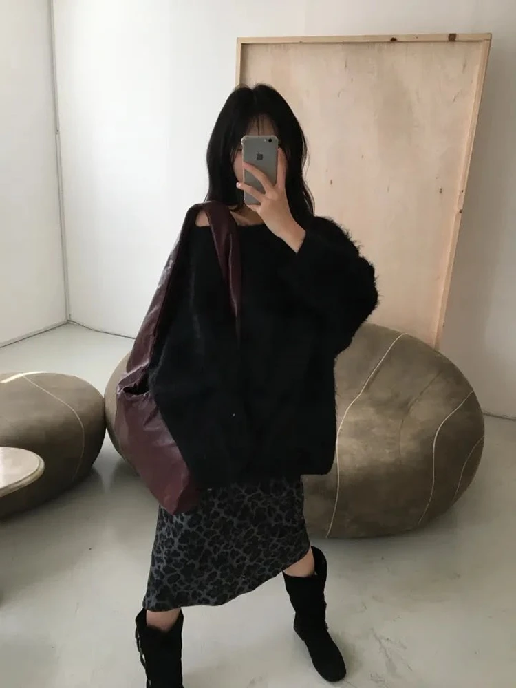

# [29CM 렌즈] AI 사진 분석 — 인터랙션 정의

> 개발 전달용 인터랙션 명세입니다. 이징은 MDS 모션 토큰(`../src/common/mds-motion.css`) 기준입니다.

- 프로토타입: `aiPhotoAnalysis/index.html` (버전 `20261115-02`)
- Figma: [[26-4Q] 29CM 렌즈](https://www.figma.com/design/8fTes280dXd8VYDwwLf8x8/-26-4Q--29CM-%EB%A0%8C%EC%A6%88?node-id=578-147386) · 결과 화면 29Lens 241:59837 / 59871 / 59905
- 수정일: 2026-11-15
- 진행: 로딩 화면 → 결과 화면 전환 → 결과 화면 상품 선택 (전체 흐름 1차 정리)
- ⚠️ **초안**: 🧪 표시 값은 아직 테스트 중입니다. 디자이너가 프로토타입 옵션창으로 값을 맞춰 본 뒤 확정하면, 명세 전체(표 · 코드 블록)를 다시 검토하고 고칩니다.

### 읽는 법

- 각 절은 **표 = 기준값(플랫폼 공통)** → **코드 = 구현 참고(웹, 프로토타입에서 그대로)** 순서입니다.
- iOS · Android는 표를 기준으로 옮기고, 웹은 코드 블록을 그대로 써도 됩니다.
- 🧪 = 테스트 중인 값 (옵션창에서 조절 가능, 확정 전). 표시 없는 값은 지금 기준값입니다.
- 모든 조절 값은 `values.css` 한 파일에 화면 순서대로 모여 있습니다 (번호가 이 문서의 절과 같은 순서).
- 코드는 프로토타입 전용 장치(옵션창 · QR · 휴대폰 실시간 동기화)를 뺀 모션 부분만 옮겼습니다.

---

## 🧪 확정 전 결정할 값 (디자이너 확인용)

프로토타입 PC 화면 오른쪽 옵션창에서 바로 바꿔 볼 수 있고, 리셋 아이콘을 누르면 아래 기본값으로 돌아갑니다. 바꾼 값은 QR 주소에 실려 휴대폰에서도 같은 값으로 열립니다.

| 옵션창 | 항목 | 지금 기본값 | 조절 범위 | 이 문서 |
|---|---|---|---|---|
| AI 사진 분석 | 분석 시간 (로딩 화면 노출) | **6초** | 1 ~ 10초 | 1-6 |
| Inner Glow | 한 바퀴 시간 (Speed) | **4s** | 1 ~ 12s | 1-4 |
| | 진하기 (Opacity) | **0.75** | 0 ~ 1 | 1-4 |
| | 두께 (Width) | **6** | 0 ~ 30 | 1-4 |
| | 흐림 (Blur) | **12** | 0 ~ 40 | 1-4 |
| Light | 지름 (Size) | **350** | 200 ~ 800 | 1-3 |
| | 진하기 (Opacity) | **0.75** | 0 ~ 1 | 1-3 |
| | 가로 한 방향 시간 (Speed X) | **2.0s** | 1 ~ 12s | 1-3 |
| | 세로 한 방향 시간 (Speed Y) | **3.0s** | 1 ~ 12s | 1-3 |

옵션창의 나머지는 확인용 장치입니다 (명세 대상 아님): **로딩 완료 · 다시 로딩** 버튼, **로딩만 보기**(분석 시간을 재지 않고 로딩 화면만 계속), Light **On**(효과를 끄고 비교).

옵션창에는 없지만 `values.css`에서 같이 정해야 하는 값: 사진 등장 줌아웃 · 숨쉬기(1-1 · 1-2), 딤 진하기(1-1), Light 이동 범위(1-3), 로딩 문구 하이라이트(1-5), 결과 화면 전환 · 포커스 · 파형 점(2 · 3절).

---

## 0. 공통 규칙

| 항목 | 규칙 |
|---|---|
| 화면 | 29CM 렌즈, **390 × 844** 기준 (상태바 50 · 앱바 60) |
| 단위 | pt (390 기준) |
| 기준점 | 따로 적지 않으면 **가운데** |
| 키프레임 이징 | 구간 이징은 그 키프레임에서 다음 키프레임까지 적용 |
| 중간에 끊길 때 | 진행 중인 모션이 있으면 **지금 값에서 이어서** 새 목표로 감 (처음 값으로 되돌리지 않음) |
| 모션 줄이기 | OS 접근성 '동작 줄이기' 켜짐 → 반복 · 장식 모션(사진 숨쉬기, Light, Inner Glow 회전, 파형 점 펄스)은 정지, 화면 전환은 바로 끝 상태 |

### 사용한 MDS 토큰

| 토큰 | 값 | 쓰는 곳 |
|---|---|---|
| `power1.easeInOut` | cubic-bezier(0.33, 0, 0.67, 1) | 사진 숨쉬기, Light 이동 |
| `power2.easeOut` | cubic-bezier(0.25, 1, 0.5, 1) | 사진 등장 줌아웃, Light 등장 |
| `power3.easeOut` | cubic-bezier(0.22, 1, 0.36, 1) | 결과 화면 포커스 이동 |
| `power3.easeInOut` | cubic-bezier(0.33, 0, 0.2, 1) | 결과 화면 전환 (사진 축소 · 바텀시트) |

### 에셋

| 에셋 | 파일 (프로토타입) | 크기 | 비고 |
|---|---|---|---|
| AI 로딩 아이콘 | `../src/components/IconAILoading/img-css/` (CSS + `IconAI.svg` 4장) | 32 | AI 로딩 아이콘 프로토타입과 같은 컴포넌트 원본 (로티 버전도 있음) |
| 결과 화면 모서리 | `img/result/crop-corner-tr.svg` · `crop-corner-bl.svg` | 11 × 11 | 왼쪽 아래는 위 오른쪽을 180° 돌린 모양 |
| 파형 점 | `img/result/dot.svg` | 14 | |
| 로딩 문구 글꼴 | 29CM Editorial 500 | 13 / 18 | 29cm.co.kr과 같은 CDN 웹폰트 |
| 사진 · 썸네일 · 상품 리스트 | `img/loading/` · `img/result/` | | 프로토타입용 (실서비스는 사용자 사진 · 검색 결과) |

---

## 1. 로딩 화면

사진을 올리면 바로 나오는 분석 중 화면. 사진 영역은 화면 세로 가운데 **390 × 520** (사진 750 × 1000 비율, cover).

**층 순서 (아래 → 위)**: 사진 → 딤 → ① Light → ② Inner Glow → ③ AI 아이콘 · 로딩 문구 / 맨 위 상태바 · 앱바

| 시점 | 무엇이 | 내용 |
|---|---|---|
| 0s | 사진 | 등장 줌아웃 (1-1) |
| 0s | Light | 등장 (사진 줌아웃과 같은 시간 · 이징) → 이동 반복 (1-3) |
| 0s | Inner Glow · AI 아이콘 · 로딩 문구 | 바로 반복 시작 (1-4 · 1-5) |
| 1.3s | 사진 | 줌아웃이 끝나면 숨쉬기 반복 (1-2) |
| 🧪 6s | 화면 | 결과 화면으로 전환 (1-6 → 2절) |

---

### 1-1. 사진 등장 (줌아웃) · 딤

| 대상 | 모션 | 값 |
|---|---|---|
| 사진 (사진 틀 안에서만, 기준점 가운데) | scale **1.08 → 1** | **1.3s** · `power2.easeOut` |
| 딤 | 검정 **60%** 고정 | 모션 없음 |

- 사진 틀(390 × 520)은 그대로, 안의 사진만 커졌다 줄어듦 (틀 밖은 잘림)

### 1-2. 사진 숨쉬기 (로딩 중 반복)

| 항목 | 값 |
|---|---|
| 모션 | scale **1 ↔ 1.04** 왕복 |
| 한 방향 시간 | **3.0s** (왕복 6s) · `power1.easeInOut` · 무한 반복 |
| 시작 | 등장 줌아웃이 끝나는 순간 (1.3s) — 줌아웃 끝 상태(1)에서 이어서 시작해 튀지 않음 |

```css
/* 프로토타입: loading.css · 값은 values.css 1 · 2 */
:root {
  --lens-landing-duration: 1.3s;
  --lens-landing-easing: var(--mds-motion-power2-easeOut);
  --lens-landing-scale: 1.08;
  --lens-breath-scale: 1.04;
  --lens-breath-duration: 3.0s;
  --lens-breath-easing: var(--mds-motion-power1-easeInOut);
  --lens-breath-delay: var(--lens-landing-duration);
}
.lens-screen .Image {
  transform-origin: 50% 50%;
  animation:
    LensLandingZoomOut var(--lens-landing-duration) var(--lens-landing-easing) both,
    LensBreath var(--lens-breath-duration) var(--lens-breath-easing) var(--lens-breath-delay) infinite alternate;
}
@keyframes LensLandingZoomOut {
  from { transform: scale(var(--lens-landing-scale)); }
  to   { transform: scale(1); }
}
@keyframes LensBreath {
  from { transform: scale(1); }
  to   { transform: scale(var(--lens-breath-scale)); }
}
.lens-screen .Dim { position: absolute; inset: 0; background: rgb(0 0 0 / 0.6); }
```

---

### 1-3. Light — 사진 위를 떠다니며 밝게 비추는 빛 🧪

딤 위에 **원본 사진을 한 장 더** 두고, 원형 마스크로 빛이 있는 자리만 보이게 합니다. 지나가는 자리만 딤이 벗겨진 듯 밝아지고, 색은 원본 사진 그대로입니다 (색을 덧칠하지 않음).

| 항목 | 값 |
|---|---|
| 지름 🧪 | **350** |
| 진하기 🧪 | **0.75** (원본 사진 층의 투명도) |
| 마스크 (가운데 → 바깥) | 0% 알파 0.62 → 45% 0.34 → 75% 0.10 → 100% 0 (원형 그라데이션, 가장자리가 부드럽게 흐려짐) |
| 이동 | 빛 중심이 사진 영역 안에서 가로 · 세로를 **따로 왕복** → 두 시간이 달라서 곡선으로 훑음 |
| 가로 범위 · 시간 🧪 | x **60 → 330** · 한 방향 **2.0s** · `power1.easeInOut` · 무한 왕복 |
| 세로 범위 · 시간 🧪 | y **60 → 460** · 한 방향 **3.0s** · `power1.easeInOut` · 무한 왕복 |
| 등장 | 투명도 0 → 1 · **사진 줌아웃과 같이 0s 시작, 1.3s · `power2.easeOut`** |
| 시작 위치 | **사진 가운데 위** — 반쯤 나타난 순간(0.65s)에 가로는 범위 한가운데(195), 세로는 맨 위(60)에서 아래로 내려가기 시작 |
| 사진 모션 | 비치는 원본 사진도 1-1 · 1-2(줌아웃 · 숨쉬기)를 똑같이 따라감 → 아래 사진과 늘 겹쳐 보임 |

- 범위는 빛 **중심** 기준 (사진 390 × 520 안)
- 시작 위치는 속도를 바꿔도 자동으로 맞음: 가로 지연 = T − 가로 시간/2, 세로 지연 = T − 세로 시간 × 2 (T = 등장 지연 + 등장 시간/2)
- 구현 방법은 자유. 프로토타입은 성능을 위해 **마스크 모양은 한 번만 그리고 움직임은 모두 transform**으로 함: 원형 창이 빛과 같이 움직이고, 안쪽 사진은 같은 시간 · 곡선으로 반대로 움직여 제자리에 있음 (매 프레임 마스크 위치를 다시 그리는 방식은 CPU 부담이 큼)

```css
/* 프로토타입: loading.css · 값은 values.css 4 */
:root {
  --lens-light-size: 350px;
  --lens-light-opacity: 0.75;
  --lens-light-x-duration: 2.0s;
  --lens-light-y-duration: 3.0s;
  --lens-light-easing: var(--mds-motion-power1-easeInOut);
  --lens-light-x-from: 60px;  --lens-light-x-to: 330px;
  --lens-light-y-from: 60px;  --lens-light-y-to: 460px;
  --lens-light-in-delay: 0s;
  --lens-light-in-duration: var(--lens-landing-duration);
  --lens-light-in-easing: var(--lens-landing-easing);
}
/* 구조: .LensLight(등장) > .LensLightX > .LensLightY(빛 중심 이동) > .LensLightMask(원형 창)
         > .LensLightMaskY > .LensLightMaskX(반대로 이동) > .Image.LensLightImage(원본 사진) */
.lens-screen .LensLight {
  position: absolute; inset: 0; overflow: hidden; pointer-events: none;
  opacity: 0;
  animation: LensLightIn var(--lens-light-in-duration) var(--lens-light-in-easing) var(--lens-light-in-delay) forwards;
}
.lens-screen .LensLightX,
.lens-screen .LensLightY,
.lens-screen .LensLightMaskX { position: absolute; left: 0; top: 0; will-change: transform; }
/* 시작 위치: 사진 가운데 위 */
.lens-screen .LensLightX,
.lens-screen .LensLightMaskX {
  --lens-light-x-delay: calc(var(--lens-light-in-delay) + var(--lens-light-in-duration) / 2 - var(--lens-light-x-duration) / 2);
}
.lens-screen .LensLightY,
.lens-screen .LensLightMaskY {
  --lens-light-y-delay: calc(var(--lens-light-in-delay) + var(--lens-light-in-duration) / 2 - var(--lens-light-y-duration) * 2);
}
.lens-screen .LensLightX { animation: LensLightMoveX var(--lens-light-x-duration) var(--lens-light-easing) var(--lens-light-x-delay) infinite alternate; }
.lens-screen .LensLightY { animation: LensLightMoveY var(--lens-light-y-duration) var(--lens-light-easing) var(--lens-light-y-delay) infinite alternate; }
.lens-screen .LensLightMask {
  position: absolute;
  left: calc(var(--lens-light-size) / -2);
  top: calc(var(--lens-light-size) / -2);
  width: var(--lens-light-size);
  height: var(--lens-light-size);
  opacity: var(--lens-light-opacity);
  mask-image: radial-gradient(circle closest-side, rgb(0 0 0 / 0.62) 0%, rgb(0 0 0 / 0.34) 45%, rgb(0 0 0 / 0.1) 75%, rgb(0 0 0 / 0) 100%);
}
.lens-screen .LensLightMaskY {
  position: absolute;
  left: calc(var(--lens-light-size) / 2);
  top: calc(var(--lens-light-size) / 2);
  will-change: transform;
  animation: LensLightBackY var(--lens-light-y-duration) var(--lens-light-easing) var(--lens-light-y-delay) infinite alternate;
}
.lens-screen .LensLightMaskX { animation: LensLightBackX var(--lens-light-x-duration) var(--lens-light-easing) var(--lens-light-x-delay) infinite alternate; }
.lens-screen .LensLightImage { position: absolute; left: 0; top: 0; width: 390px; height: 520px; }
@keyframes LensLightIn    { to { opacity: 1; } }
@keyframes LensLightMoveX { from { transform: translateX(var(--lens-light-x-from)); } to { transform: translateX(var(--lens-light-x-to)); } }
@keyframes LensLightMoveY { from { transform: translateY(var(--lens-light-y-from)); } to { transform: translateY(var(--lens-light-y-to)); } }
@keyframes LensLightBackX { from { transform: translateX(calc(var(--lens-light-x-from) * -1)); } to { transform: translateX(calc(var(--lens-light-x-to) * -1)); } }
@keyframes LensLightBackY { from { transform: translateY(calc(var(--lens-light-y-from) * -1)); } to { transform: translateY(calc(var(--lens-light-y-to) * -1)); } }
```

```html
<!-- 프로토타입: index.html — 사진 영역(.AILoading) 안, Inner Glow 아래 -->
<div class="LensLight" aria-hidden="true"><div class="LensLightX"><div class="LensLightY">
  <div class="LensLightMask"><div class="LensLightMaskY"><div class="LensLightMaskX">
    <div class="Image LensLightImage"></div>
  </div></div></div>
</div></div></div>
```

---

### 1-4. Inner Glow — 사진 테두리를 도는 색 글로우 🧪

| 항목 | 값 |
|---|---|
| 모양 | 사진 영역 안쪽 테두리 (안쪽으로 두께만큼), conic 그라데이션 |
| 색 (고정) | `#86BAFF` 0° → `#E476FF` 90° → `#878FFF` 225° → `#86BAFF` 360° |
| 회전 🧪 | 그라데이션 시작 각도 0° → 360° · 한 바퀴 **4s** · linear · 무한 반복 |
| 진하기 🧪 | **0.75** |
| 두께 🧪 | **6** |
| 흐림 🧪 | blur **12** |

```css
/* 프로토타입: loading.css · 값은 values.css 5 */
:root {
  --inner-glow-duration: 4s;
  --inner-glow-opacity: 0.75;
  --inner-glow-width: 6px;
  --inner-glow-blur: 12px;
  --ai-effect-color-1: #86baff;
  --ai-effect-color-2: #e476ff;
  --ai-effect-color-3: #878fff;
}
@property --inner-glow-angle { syntax: '<angle>'; inherits: false; initial-value: 0deg; }
@keyframes InnerGlowRotate {
  from { --inner-glow-angle: 0deg; }
  to   { --inner-glow-angle: 360deg; }
}
.lens-screen .InnerGlow {
  position: absolute; inset: 0; pointer-events: none;
  opacity: var(--inner-glow-opacity);
  filter: blur(var(--inner-glow-blur));
}
.lens-screen .InnerGlow::before {
  content: "";
  position: absolute;
  inset: 0;
  padding: var(--inner-glow-width);
  background: conic-gradient(from var(--inner-glow-angle),
    var(--ai-effect-color-1) 0deg, var(--ai-effect-color-2) 90deg,
    var(--ai-effect-color-3) 225deg, var(--ai-effect-color-1) 360deg);
  /* 가운데를 비우고 테두리만 남김 */
  -webkit-mask: linear-gradient(#fff 0 0) content-box, linear-gradient(#fff 0 0);
  -webkit-mask-composite: xor;
  mask: linear-gradient(#fff 0 0) content-box, linear-gradient(#fff 0 0);
  mask-composite: exclude;
  animation: InnerGlowRotate var(--inner-glow-duration) linear infinite;
}
```

---

### 1-5. AI 아이콘 · 로딩 문구

사진 영역 가운데, 아이콘 32 아래 간격 6에 문구 "AI가 사진을 분석중입니다".

| 대상 | 모션 | 값 |
|---|---|---|
| AI 로딩 아이콘 | 컴포넌트 원본 그대로 | 32 · 한 바퀴 **1.8s** · linear · 무한 반복 (AI 로딩 아이콘 프로토타입 · 컴포넌트 CSS 기준) |
| 로딩 문구 | 글자 색 흰색 70% 고정, 흰 하이라이트가 왼쪽 → 오른쪽으로 지나감 | 주기 **3.0s** · linear · 무한 반복 |
| | 하이라이트 | 90° 선형 그라데이션 (투명 → 흰색 100% → 투명), 폭은 문구 너비의 **20%** |
| 글꼴 | 29CM Editorial 500 · 13 / 18 | |

```css
/* 프로토타입: loading.css · 값은 values.css 6 */
.lens-screen .LoadingMsg p {
  position: relative;
  margin: 0;
  font-family: "29CM Editorial", Pretendard, sans-serif;
  font-size: 13px; font-weight: 500; line-height: 18px;
  color: rgb(255 255 255 / 0.7);
}
.lens-screen .LoadingMsg p[data-text]::after {   /* 같은 글자를 겹쳐 하이라이트만 보이게 */
  content: attr(data-text);
  position: absolute; inset: 0;
  color: transparent;
  background-image: linear-gradient(90deg, transparent 0%, #fff 50%, transparent 100%);
  background-size: 20% 100%;
  background-repeat: no-repeat;
  background-position: -100% 0;
  -webkit-background-clip: text;
  background-clip: text;
  animation: LoadingMsgShimmer 3s linear infinite;
}
@keyframes LoadingMsgShimmer {
  0%   { background-position: -100% 0; }
  100% { background-position: 200% 0; }
}
```

---

### 1-6. 노출 시간 · 결과 화면으로 🧪

| 항목 | 값 |
|---|---|
| 프로토타입 | **6초** 뒤 자동으로 결과 화면 (2절) 🧪 |
| 실서비스 (제안) | 최소 노출 시간이 지나고 **분석 결과가 오면** 넘어감 (둘 중 늦은 쪽) — 최소 시간은 디자이너 확인 후 확정 |
| 결과 화면 전환 시점의 사진 | 줌아웃 · 숨쉬기 중 **지금 배율에서 이어서** 결과 크기로 줄어듦 (2-1) |

---

## 2. 결과 화면 전환

로딩이 끝나면 로딩 화면이 결과 화면으로 바뀌고, 사진이 로딩 크기에서 결과 크기로 줄어들며 바텀시트가 아래에서 올라옵니다. 결과 화면은 **상태바 50 · 앱바 60 · 사진 영역 292 · 바텀시트 442**.

| 대상 | 시작 (로딩 화면과 같은 자리) | 끝 | 값 |
|---|---|---|---|
| 사진 · 딤 | 390 × 520 (화면 y 162), 배율 = 로딩 사진의 지금 배율 | **186.03 × 280** (사진 영역 위 6, 가운데), 배율 1 | **0.7s** · `power3.easeInOut` |
| 딤 | 검정 **58%** 고정 (Figma, 로딩 화면 60%와 거의 같아 이어 보임) | 같음 | 크기만 사진과 같이 바뀜 |
| 바텀시트 (위 모서리 20) | 화면 아래 바깥 | 제자리 | **0.7s** · `power3.easeInOut` · **0.15s 늦게** 출발 |

- 사진 · 딤 · 밝은 창 · 모서리는 **같은 시간 · 곡선으로 함께** 움직임 (어긋나 보이지 않게 한 번에 그림)
- 로딩 사진이 숨쉬기 중(최대 1.04배)이면 그 배율에서 1로 같이 줄어듦 → 화면이 튀지 않음
- 사진은 크기가 바뀌는 동안에도 비율대로 채움(cover)

### 2-1. 밝은 창 · 모서리 진입

결과 화면은 딤 위에 같은 사진을 한 장 더 두고 **밝은 창**(둥근 사각형, 모서리 4)으로 잘라, 선택된 상품만 밝게 보여 줍니다. 창의 위 오른쪽 · 아래 왼쪽에 모서리 표시(10 × 10).

| 대상 | 시작 | 끝 | 값 |
|---|---|---|---|
| 밝은 창 | 첫 상품 영역의 **가운데 한 점** (로딩 크기 사진 위) | 첫 상품 영역 | 사진 축소와 같이 **0.7s** · `power3.easeInOut` |
| | 투명도 0 | 1 | 위와 같음 |
| 모서리 2개 | 창 가운데 한 점 · 투명도 0 | 창 모서리 · 투명도 1 | 위와 같음 |

- 시작 화면이 로딩 화면(사진 전체가 어두움)과 같아 끊김 없이 이어짐
- 창은 상품 영역보다 작아지지 않게 **최소 24 × 24**, 사진 틀 밖으로 나간 부분은 잘라 냄

### 2-2. 파형 점

상품마다 점 하나 (14, 흰색). 선택된 상품의 점은 숨김.

| 항목 | 값 |
|---|---|
| 등장 | 투명도 0 → 1 · **0.2s** ease — 사진 축소가 **끝나는 순간에 같이 끝나도록** 시작 (지연 = 0.7 − 0.2 = 0.5s) |
| 펄스 (무한 반복) | 점과 같은 14 고리(흰색 70%, 선 1.4)가 scale **1 → 2** 커지며 투명도 **0.7 → 0** · **2.0s** ease · 1.5s 뒤 시작 |
| 누르는 영역 | **46 × 46** (점 14 + 사방 16) |

```js
// 프로토타입: js/flow.js — 결과 화면으로 (요약)
// 로딩 사진의 지금 배율을 읽어, 결과 사진이 그 배율에서 1로 같은 곡선으로 줄어들게 함
var t = getComputedStyle(loadingImage).transform;
var zoomNow = (t && t !== 'none') ? new DOMMatrixReadOnly(t).a : 1;
loadingScreen.hidden = true;
resultScreen.hidden = false;
// is-sheet-down 을 떼면: 바텀시트는 CSS transition으로 올라오고(0.15s 늦게),
// 사진 · 딤 · 밝은 창 · 모서리는 frameMotion이 0.7s · power3.easeInOut 으로 매 프레임 함께 그림
frameMotion(function () { result.classList.remove('is-sheet-down'); },
            '--lens-sheet-duration', '--lens-sheet-easing', zoomNow);
```

```css
/* 프로토타입: result.css · 값은 values.css 7 · 9 */
:root {
  --lens-sheet-duration: 0.7s;
  --lens-sheet-easing: var(--mds-motion-power3-easeInOut);
  --lens-sheet-delay: 0.15s;
  --lens-overlay-duration: 0.2s;
  --lens-pulse-duration: 2.0s;
  --lens-pulse-delay: 1.5s;
  --lens-pulse-scale: 2.0;
  --lens-pulse-opacity: 0.7;
}
.lens-result-sheet {
  position: absolute; left: 0; right: 0; bottom: 0;
  height: 442px;
  border-radius: 20px 20px 0 0;
  background: #fff;
  transform: translateY(0);
  transition: transform var(--lens-sheet-duration) var(--lens-sheet-easing) var(--lens-sheet-delay);
}
.lens-result.is-sheet-down .lens-result-sheet { transform: translateY(100%); transition: none; }
/* 파형 점: 사진 축소가 끝나는 순간에 같이 다 나타남 */
.lens-result-photo .crop-points {
  opacity: 1;
  transition: opacity var(--lens-overlay-duration) ease max(0s, calc(var(--lens-sheet-duration) - var(--lens-overlay-duration)));
}
.lens-result.is-sheet-down .crop-points { opacity: 0; transition: none; }
.lens-result-photo .crop-point::after {     /* 펄스 고리 */
  content: "";
  position: absolute; left: 50%; top: 50%;
  width: 14px; height: 14px; margin: -7px 0 0 -7px;
  border: 1.4px solid rgba(255, 255, 255, 0.7);
  border-radius: 50%;
  animation: LensPointPulse var(--lens-pulse-duration) ease var(--lens-pulse-delay) infinite;
}
@keyframes LensPointPulse {
  0%   { transform: scale(1); opacity: var(--lens-pulse-opacity); }
  100% { transform: scale(var(--lens-pulse-scale)); opacity: 0; }
}
```

---

## 3. 결과 화면

### 3-1. 상품 선택 (썸네일 · 파형 점)

바텀시트의 썸네일(52 원, 간격 8) 또는 사진 위 파형 점을 누르면 그 상품으로 포커스가 옮겨 갑니다.

| 대상 | 모션 | 값 |
|---|---|---|
| 밝은 창 · 모서리 | 지금 상품 영역 → 새 상품 영역 (같이 출발, 같이 도착) | **0.4s** · `power3.easeOut` |
| 썸네일 | 선택: 검정 테두리 1.4 + 안쪽 여백 2, 투명도 1 / 미선택: 투명도 0.4 | 모션 없이 바로 |
| 상품 리스트 (바텀시트 안) | 선택한 상품 리스트로 | 모션 없이 바로 전환 |
| 파형 점 | 선택된 상품의 점은 바로 숨김, 나머지는 투명도 0 → 1 | **0.2s** ease |

- 이동 중에 다른 상품을 누르면 **지금 위치에서 이어서** 새 상품으로 감

### 3-2. 상품 좌표 데이터 (AI 응답)

창 · 모서리 · 파형 점 위치는 AI 분석 결과의 **비율 좌표**로 계산합니다. 어떤 크기의 사진이 와도 같은 방식으로 계산됩니다.

| 값 | 내용 |
|---|---|
| `box` | 사진 안 상품 영역 — x · y(왼쪽 위) · w · h, 모두 **사진 원본 기준 0 ~ 1 비율** |
| `point` | 파형 점 자리 (0 ~ 1 비율). 없으면 `box` 가운데 |
| 화면 위치 계산 | 사진이 틀(결과 186.03 × 280, 로딩 390 × 520)에 cover로 들어가므로, 확대 배율과 잘린 양을 빼서 틀 안 좌표로 바꿈 |

```js
// 프로토타입: js/result.js — 비율 좌표 → 틀 안 좌표 (cover)
function frameGeom(frame, imageW, imageH) {
    var scale = Math.max(frame.w / imageW, frame.h / imageH);
    var dw = imageW * scale, dh = imageH * scale;
    return { w: frame.w, h: frame.h, dw: dw, dh: dh, ox: (dw - frame.w) / 2, oy: (dh - frame.h) / 2 };
}
function toFrame(g, nx, ny) { return { x: nx * g.dw - g.ox, y: ny * g.dh - g.oy }; }
// 창 = toFrame(box 왼쪽 위) ~ toFrame(box 오른쪽 아래), 틀 밖은 잘라 냄, 최소 24 × 24
```

```json
// 프로토타입: index.html 의 lensResultData (Figma 29Lens 위치를 이 사진 기준 비율로 바꾼 값)
{ "id": "top", "name": "상의",
  "box": { "x": 0.2953, "y": 0.2821, "w": 0.4523, "h": 0.425 },
  "point": { "x": 0.5667, "y": 0.3893 } }
```

---

## 프로토타입 파일 구성

| 파일 | 내용 | 전달 |
|---|---|---|
| `values.css` | 조절 값 전부 (이 문서 절 순서) | ✅ |
| `loading.css` | 로딩 화면 | ✅ |
| `result.css` | 결과 화면 | ✅ |
| `js/result.js` | 결과 화면 모션 · 상품 좌표 계산 | ✅ |
| `js/flow.js` | 로딩 → 결과 흐름, 분석 시간 | ✅ |
| `layout.css` | 폰 틀 · 휴대폰 화면 맞춤 | 참고 |
| `controls.css` · `js/controls.js` | 옵션창 (테스트용) | ❌ 프로토타입 전용 |
| `js/sync.js` | QR 주소 · 휴대폰 실시간 동기화 | ❌ 프로토타입 전용 |
