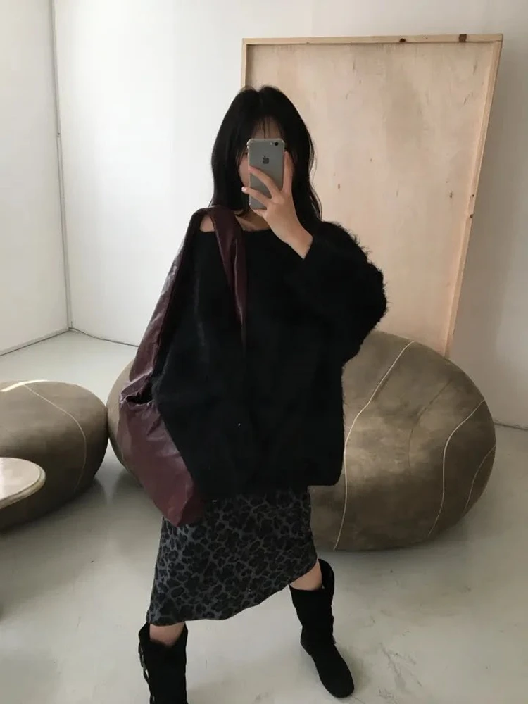

# [29CM 렌즈] AI 사진 분석 — 인터랙션 정의

> 개발 전달용 인터랙션 명세입니다. 이징은 MDS 모션 토큰(`../src/common/mds-motion.css`) 기준입니다.

- 프로토타입: `aiPhotoAnalysis/index.html` (버전 `20261117-7`)
- Figma: [[26-4Q] 29CM 렌즈](https://www.figma.com/design/8fTes280dXd8VYDwwLf8x8/-26-4Q--29CM-%EB%A0%8C%EC%A6%88?node-id=578-147386) · 분석 중 29Lens 636:28622 · 결과 화면 29Lens 241:59837 / 59871 / 59905
- 수정일: 2026-11-17 (값 확정 · 분석 중(A) / 분석 완료(B) 파트로 나눔)
- ✅ **확정**: 디자이너와 맞춘 값입니다. 이 문서의 표 · 코드 블록 값은 프로토타입과 같습니다.

## 문서 구조 (먼저 읽기)

이 기능은 **화면 두 개, 상태 두 개**입니다. 문서도 그대로 두 파트로 나눴습니다.

| 파트 | 상태 | 언제 | 시간 기준 (0s) | 주요 모션 |
|---|---|---|---|---|
| **A. 분석 중 화면** | `analyzing` | 사진을 올린 직후 ~ 분석 결과가 오기 전 | 분석 중 화면이 처음 보인 순간 | 사진 줌아웃 · 숨쉬기, 딤, Light(밝힘 마스크 + 빛 구체), AI 아이콘, 로딩 문구 |
| **B. 분석 완료 화면** | `done` | 분석 결과가 온 순간 ~ | 분석 완료 순간 | 사진 축소 · 바텀시트, 선택 영역 · 모서리 등장, 도트 등장 · 펄스, 상품 선택 시 선택 영역 이동 |

```
[사진 업로드] → A. 분석 중 (반복 모션) ──(분석 완료: 최소 노출 시간 ∧ 결과 도착)──→ B. 분석 완료 (전환 0 ~ 0.85s → 결과 화면 대기)
                                                                                     └─ 상품 선택(썸네일 · 도트 탭) → B-5
```

### 읽는 법 (사람 · AI 공통)

- 파트 → 절(A-1, B-2 …) → **표 = 기준값(플랫폼 공통)** → **코드 = 구현 참고(웹, 프로토타입 그대로)** 순서입니다.
- 각 파트 맨 앞의 **타임라인 표(A-0 · B-0-1)** 가 그 파트 모션 전체 목록입니다. 시작 · 끝 · 시간 · 이징이 여기 다 있고, 아래 절은 세부입니다.
- 용어: **선택 영역** = 결과 화면 사진에서 선택된 상품만 밝게 보이는 둥근 사각형 창(프로토타입 `.crop-reveal`). **도트** = 상품마다 하나씩 있는 흰 점(파형 점, `.crop-point`). **펄스** = 도트에서 고리가 커지며 사라지는 반복 모션.
- iOS · Android는 표를 기준으로 옮기고, 웹은 코드 블록을 그대로 써도 됩니다.
- 모든 조절 값은 `css/values.css` 한 파일에 화면 순서대로 모여 있습니다 (1 ~ 5 = A 파트, 6 ~ 8 = B 파트).
- 코드는 프로토타입 전용 장치(옵션창 · QR · 휴대폰 실시간 동기화)를 뺀 모션 부분만 옮겼습니다.

---

## 공통 규칙 (A · B 모두)

| 항목 | 규칙 |
|---|---|
| 화면 | 29CM 렌즈, **390 × 844** 기준 (상태바 50 · 앱바 60) |
| 단위 | pt (390 기준) |
| 기준점 | 따로 적지 않으면 **가운데** |
| 키프레임 이징 | 구간 이징은 그 키프레임에서 다음 키프레임까지 적용 |
| 중간에 끊길 때 | 진행 중인 모션이 있으면 **지금 값에서 이어서** 새 목표로 감 (처음 값으로 되돌리지 않음) |
| 모션 줄이기 | OS 접근성 '동작 줄이기' 켜짐 → 반복 · 장식 모션(사진 등장 · 숨쉬기, 딤 등장, Light 이동, 파형 점 펄스)은 정지 — Light는 사진 가운데에 멈춘 채 보임. 화면 전환은 바로 끝 상태 |

### 사용한 MDS 토큰

| 토큰 | 값 | 쓰는 곳 |
|---|---|---|
| `power1.easeInOut` | cubic-bezier(0.33, 0, 0.67, 1) | 사진 숨쉬기, Light 이동 |
| `power2.easeOut` | cubic-bezier(0.25, 1, 0.5, 1) | 사진 등장 줌아웃, Light 등장 |
| `power3.easeOut` | cubic-bezier(0.22, 1, 0.36, 1) | 결과 화면 포커스 이동 |
| `power3.easeInOut` | cubic-bezier(0.33, 0, 0.2, 1) | 결과 화면 전환 (사진 축소 · 바텀시트) |

### 에셋

| 에셋 | 파일 (프로토타입) | 크기 | 비고 |
|---|---|---|---|
| AI 로딩 아이콘 | `../src/components/IconAILoading/img-css/` (CSS + `IconAI.svg` 4장) | 32 | AI 로딩 아이콘 프로토타입과 같은 컴포넌트 원본 (로티 버전도 있음) |
| 결과 화면 모서리 | `img/result/crop-corner-tr.svg` · `crop-corner-bl.svg` | 11 × 11 | 왼쪽 아래는 위 오른쪽을 180° 돌린 모양 |
| 파형 점 | `img/result/dot.svg` | 14 | |
| 로딩 문구 글꼴 | 29CM Editorial 500 | 13 / 18 | 29cm.co.kr과 같은 CDN 웹폰트 |
| 사진 · 썸네일 · 상품 리스트 | `img/loading/` · `img/result/` | | 프로토타입용 (실서비스는 사용자 사진 · 검색 결과) |

> 무신사 AI 효과 색 `#86BAFF` · `#E476FF` · `#878FFF` (Inner Glow에 쓰던 색)는 지금 화면에 쓰지 않고 css/values.css에 보관. 빛 구체(A-3-2)는 29CM 렌즈 펄 톤을 씀.

---

# A. 분석 중 화면 (로딩)

> 이 파트는 **사진을 올린 순간부터 분석이 끝나기 전까지**입니다. A 파트의 시간은 모두 **분석 중 화면이 처음 보인 순간 = 0s** 기준입니다.

사진을 올리면 바로 나오는 분석 중 화면. 사진 영역은 화면 세로 가운데 **390 × 520** (사진 750 × 1000 비율, cover).

**층 순서 (아래 → 위)**: 사진 → 딤 → ① Light 밝힘 마스크 → ② Light 빛 구체 (Orb) → ③ AI 아이콘 · 로딩 문구 / 맨 위 상태바 · 앱바

## A-0. 분석 중 타임라인 (한눈에)

| 시작 | 끝 | 대상 | 모션 | 시간 · 이징 | 절 |
|---|---|---|---|---|---|
| 0s | 1s | 사진 | scale 1.1 → 1 (등장 줌아웃) | 1s · `power2.easeOut` | A-1 |
| 0s | 1s | 딤 | 투명도 0 → 1 (검정 60%) | 1s · `power2.easeOut` | A-1 |
| 1s | 반복 | 사진 | scale 1 ↔ 1.04 (숨쉬기) | 한 방향 3.0s · `power1.easeInOut` · 왕복 무한 | A-2 |
| 0s | 1s | Light (밝힘 마스크 + 빛 구체) | 투명도 0 → 1 (등장) | 1s · `power2.easeOut` | A-3 |
| 0s | 반복 | Light | 가로 x 60 ↔ 330 / 세로 y 60 ↔ 460 (사진 가운데에서 왼쪽 위로 출발) | 가로 한 방향 2.0s · 세로 3.0s · `power1.easeInOut` · 왕복 무한 | A-3 |
| 0s | 반복 | AI 아이콘 | 컴포넌트 원본 모션 | 1.8s · linear · 무한 | A-4 |
| 0s | 반복 | 로딩 문구 | 흰 하이라이트가 왼쪽 → 오른쪽 | 3.0s · linear · 무한 | A-4 |
| 6s | — | 화면 | 분석 완료 → B 파트로 (프로토타입 기준, 실서비스는 A-5) | — | A-5 |

---

## A-1. 사진 등장 (줌아웃) · 딤

| 대상 | 모션 | 값 |
|---|---|---|
| 사진 (사진 틀 안에서만, 기준점 가운데) | scale **1.1 → 1** | **1s** · `power2.easeOut` |
| 딤 | 투명도 0 → 1 (검정 **60%**까지) | 사진과 같이 **0s 시작 · 1s · `power2.easeOut`** |

- 사진 틀(390 × 520)은 그대로, 안의 사진만 커졌다 줄어듦 (틀 밖은 잘림)

## A-2. 사진 숨쉬기 (로딩 중 반복)

| 항목 | 값 |
|---|---|
| 모션 | scale **1 ↔ 1.04** 왕복 |
| 한 방향 시간 | **3.0s** (왕복 6s) · `power1.easeInOut` · 무한 반복 |
| 시작 | 등장 줌아웃이 끝나는 순간 (1s) — 줌아웃 끝 상태(1)에서 이어서 시작해 튀지 않음 |

```css
/* 프로토타입: css/loading.css · 값은 css/values.css 1 · 2 */
:root {
  --lens-landing-duration: 1s;
  --lens-landing-easing: var(--mds-motion-power2-easeOut);
  --lens-landing-scale: 1.1;
  --lens-breath-scale: 1.04;
  --lens-breath-duration: 3.0s;
  --lens-breath-easing: var(--mds-motion-power1-easeInOut);
  --lens-breath-delay: var(--lens-landing-duration);
}
.lens-screen .Image {
  transform-origin: 50% 50%;
  animation:
    LensLandingZoomOut var(--lens-landing-duration) var(--lens-landing-easing) both,
    LensBreath var(--lens-breath-duration) var(--lens-breath-easing) var(--lens-breath-delay) infinite alternate;
}
@keyframes LensLandingZoomOut {
  from { transform: scale(var(--lens-landing-scale)); }
  to   { transform: scale(1); }
}
@keyframes LensBreath {
  from { transform: scale(1); }
  to   { transform: scale(var(--lens-breath-scale)); }
}
.lens-screen .Dim {
  position: absolute; inset: 0;
  background: rgb(0 0 0 / 0.6);
  animation: LensDimIn var(--lens-landing-duration) var(--lens-landing-easing) both;   /* 사진 줌아웃과 같이 */
}
@keyframes LensDimIn {
  from { opacity: 0; }
  to   { opacity: 1; }
}
```

---

## A-3. Light — 사진 위를 떠다니며 밝게 비추는 빛

두 겹이 **같은 중심으로 함께** 움직입니다: A-3-1 밝힘 마스크(원본 사진이 비침) + A-3-2 빛 구체(밝힘 마스크 위에 펄 톤 빛을 얹음). 이동 · 등장은 아래 표를 같이 씁니다.

### A-3-1. 밝힘 마스크

딤 위에 **원본 사진을 한 장 더** 두고, 원형 마스크로 빛이 있는 자리만 보이게 합니다. 지나가는 자리만 딤이 벗겨진 듯 밝아지고, 색은 원본 사진 그대로입니다 (색을 덧칠하지 않음).

| 항목 | 값 |
|---|---|
| 지름 | **600** (디자이너 샘플과 같음, 반지름 300) |
| 진하기 | **0.78** (원본 사진 층의 투명도, 디자이너 샘플과 같음) |
| 마스크 단계 (가운데 → 바깥) | 0% 알파 **0.62** → 45% **0.34** → 75% **0.10** → 100% 0 (원형 그라데이션, 가장자리가 부드럽게 흐려짐, 디자이너 샘플과 같음) |
| 실제 밝기 | 마스크 단계값 × 진하기 — 기본값이면 가운데 0.62 × 0.78 ≈ **0.48** |
| 이동 | 빛 중심이 사진 영역 안에서 가로 · 세로를 **따로 왕복** → 두 시간이 달라서 곡선으로 훑음 |
| 가로 범위 · 시간 | x **60 → 330** · 한 방향 **2.0s** · `power1.easeInOut` · 무한 왕복 |
| 세로 범위 · 시간 | y **60 → 460** · 한 방향 **3.0s** · `power1.easeInOut` · 무한 왕복 |
| 등장 | 투명도 0 → 1 · **사진 줌아웃과 같이 0s 시작, 1s · `power2.easeOut`** |
| 시작 위치 | **사진 가운데** — 나타나기 시작하는 순간(0s) 가로 · 세로 모두 범위 한가운데(195, 260)에서 **왼쪽 · 위로** 움직이기 시작 |
| 사진 모션 | 비치는 원본 사진도 A-1 · A-2(줌아웃 · 숨쉬기)를 똑같이 따라감 → 아래 사진과 늘 겹쳐 보임 |

- 범위는 빛 **중심** 기준 (사진 390 × 520 안)
- **사진 영역과 밝힘 마스크 안 사진은 반드시 같은 크기(390 × 520)** 여야 두 사진이 정확히 겹침. 크기는 px로 고정 (비율 `aspect-ratio`로 정하면 iOS 사파리가 grid 안에서 상자를 늘리는 경우가 있어, cover 사진이 커지고 두 겹으로 보일 수 있음)
- 시작 위치는 속도를 바꿔도 자동으로 맞음: 지연 = 등장 지연 − 한 방향 시간 × 1.5 (돌아오는 구간 한가운데, 가로 · 세로 같음)
- 구현 방법은 자유. 프로토타입은 성능을 위해 **마스크 모양은 한 번만 그리고 움직임은 모두 transform**으로 함: 원형 창이 빛과 같이 움직이고, 안쪽 사진은 같은 시간 · 곡선으로 반대로 움직여 제자리에 있음 (매 프레임 마스크 위치를 다시 그리는 방식은 CPU 부담이 큼)

```css
/* 프로토타입: css/loading.css · 값은 css/values.css 4 */
:root {
  --lens-light-size: 600px;
  --lens-light-opacity: 0.78;
  --lens-light-stop-1: 0.62;   /* 마스크 가운데 0% */
  --lens-light-stop-2: 0.34;   /* 45% */
  --lens-light-stop-3: 0.1;    /* 75% (100%는 늘 0) */
  --lens-light-x-duration: 2.0s;
  --lens-light-y-duration: 3.0s;
  --lens-light-easing: var(--mds-motion-power1-easeInOut);
  --lens-light-x-from: 60px;  --lens-light-x-to: 330px;
  --lens-light-y-from: 60px;  --lens-light-y-to: 460px;
  --lens-light-in-delay: 0s;
  --lens-light-in-duration: var(--lens-landing-duration);
  --lens-light-in-easing: var(--lens-landing-easing);
}
/* 구조: .LensLight(등장) > .LensLightX > .LensLightY(빛 중심 이동) > .LensLightMask(원형 창)
         > .LensLightMaskY > .LensLightMaskX(반대로 이동) > .Image.LensLightImage(원본 사진) */
.lens-screen .LensLight {
  position: absolute; inset: 0; overflow: hidden; pointer-events: none;
  opacity: 0;
  animation: LensLightIn var(--lens-light-in-duration) var(--lens-light-in-easing) var(--lens-light-in-delay) forwards;
}
.lens-screen .LensLightX,
.lens-screen .LensLightY,
.lens-screen .LensLightMaskX { position: absolute; left: 0; top: 0; will-change: transform; }
/* 시작 위치: 사진 가운데, 왼쪽 위로 출발 */
.lens-screen .LensLightX,
.lens-screen .LensLightMaskX {
  --lens-light-x-delay: calc(var(--lens-light-in-delay) - var(--lens-light-x-duration) * 1.5);
}
.lens-screen .LensLightY,
.lens-screen .LensLightMaskY {
  --lens-light-y-delay: calc(var(--lens-light-in-delay) - var(--lens-light-y-duration) * 1.5);
}
.lens-screen .LensLightX { animation: LensLightMoveX var(--lens-light-x-duration) var(--lens-light-easing) var(--lens-light-x-delay) infinite alternate; }
.lens-screen .LensLightY { animation: LensLightMoveY var(--lens-light-y-duration) var(--lens-light-easing) var(--lens-light-y-delay) infinite alternate; }
.lens-screen .LensLightMask {
  position: absolute;
  left: calc(var(--lens-light-size) / -2);
  top: calc(var(--lens-light-size) / -2);
  width: var(--lens-light-size);
  height: var(--lens-light-size);
  opacity: var(--lens-light-opacity);
  mask-image: radial-gradient(circle closest-side,
    rgb(0 0 0 / var(--lens-light-stop-1)) 0%, rgb(0 0 0 / var(--lens-light-stop-2)) 45%,
    rgb(0 0 0 / var(--lens-light-stop-3)) 75%, rgb(0 0 0 / 0) 100%);
}
.lens-screen .LensLightMaskY {
  position: absolute;
  left: calc(var(--lens-light-size) / 2);
  top: calc(var(--lens-light-size) / 2);
  will-change: transform;
  animation: LensLightBackY var(--lens-light-y-duration) var(--lens-light-easing) var(--lens-light-y-delay) infinite alternate;
}
.lens-screen .LensLightMaskX { animation: LensLightBackX var(--lens-light-x-duration) var(--lens-light-easing) var(--lens-light-x-delay) infinite alternate; }
.lens-screen .LensLightImage { position: absolute; left: 0; top: 0; width: 390px; height: 520px; }
@keyframes LensLightIn    { to { opacity: 1; } }
@keyframes LensLightMoveX { from { transform: translateX(var(--lens-light-x-from)); } to { transform: translateX(var(--lens-light-x-to)); } }
@keyframes LensLightMoveY { from { transform: translateY(var(--lens-light-y-from)); } to { transform: translateY(var(--lens-light-y-to)); } }
@keyframes LensLightBackX { from { transform: translateX(calc(var(--lens-light-x-from) * -1)); } to { transform: translateX(calc(var(--lens-light-x-to) * -1)); } }
@keyframes LensLightBackY { from { transform: translateY(calc(var(--lens-light-y-from) * -1)); } to { transform: translateY(calc(var(--lens-light-y-to) * -1)); } }
```

```html
<!-- 프로토타입: index.html — 사진 영역(.AILoading) 안, AI 아이콘 · 문구 아래 -->
<div class="LensLight" aria-hidden="true"><div class="LensLightX"><div class="LensLightY">
  <div class="LensLightMask"><div class="LensLightMaskY"><div class="LensLightMaskX">
    <div class="Image LensLightImage"></div>
  </div></div></div>
  <div class="LensOrb"></div>  <!-- 빛 구체 (밝힘 마스크 위) -->
</div></div></div>
```

### A-3-2. 빛 구체 (Orb)

밝힘 마스크 **위**에 얹는 **펄 톤 빛**. 디자이너 샘플과 같은 구조이고, 색은 29CM 렌즈 펄 톤입니다.

| 항목 | 값 |
|---|---|
| 색 | 가운데 `#FFFFFF` → 중간 `#FFE8CE` → 바깥 `#C4DAFF` (29CM 렌즈 펄 톤 · 디자이너 샘플과 같은 색) |
| 그라데이션 | 원형, **위치는 반지름 기준 (0% = 가운데, 100% = 원 끝)** |

| 색 | 색상 | 위치 | 진하기 (알파) |
|---|---|---|---|
| Color 1 | `#FFFFFF` | 15% | 0.50 |
| Color 2 | `#FFE8CE` | 45% | 0.50 |
| Color 3 | `#C4DAFF` | 85% (= Fade start) | 0.50 |
| Fade end | Color 3 | 90% | 0 (Color 3 위치 85% → 90%에서 투명해짐) |

| 항목 | 값 |
|---|---|
| 지름 | **560** (원형으로 자름, 90% 바깥은 투명) |
| 진하기 | **0.40** (층 전체) |
| 흐림 | blur **30** |
| 블렌드 | Normal |
| 층 순서 | **밝힘 마스크 위** (디자이너 샘플과 같음) |
| 이동 · 등장 | 밝힘 마스크와 같은 중심 · 같은 등장 (A-3 표) |

```css
/* 프로토타입: css/loading.css · 값은 css/values.css 4-2 */
:root {
  --lens-orb-color-1: #ffffff;
  --lens-orb-color-2: #ffe8ce;
  --lens-orb-color-3: #c4daff;
  --lens-orb-size: 560px;
  --lens-orb-opacity: 0.4;
  --lens-orb-blur: 30px;
  --lens-orb-pos-1: 15%;     /* 색 1 위치 */
  --lens-orb-stop-1: 0.5;    /* 색 1 진하기 */
  --lens-orb-stop-2: 0.5;    /* 색 2 진하기 */
  --lens-orb-pos-2: 45%;     /* 색 2 위치 (반지름 기준) */
  --lens-orb-stop-3: 0.5;    /* 색 3 진하기 */
  --lens-orb-pos-3: 85%;     /* 색 3 위치 = Fade start */
  --lens-orb-end: 90%;       /* Fade end */
}
/* .LensLightY(빛 중심) 안. 층 순서: 빛 구체가 밝힘 마스크 위 */
.lens-screen .LensLightMask { z-index: 1; }
.lens-screen .LensOrb { z-index: 2; }
.lens-screen .LensOrb {
  position: absolute;
  left: calc(var(--lens-orb-size) / -2);
  top: calc(var(--lens-orb-size) / -2);
  width: var(--lens-orb-size);
  height: var(--lens-orb-size);
  border-radius: 50%;
  opacity: var(--lens-orb-opacity);
  filter: blur(var(--lens-orb-blur));
  background: radial-gradient(circle closest-side at 50% 50%,   /* closest-side: 100% = 원 끝 */
    rgb(from var(--lens-orb-color-1) r g b / var(--lens-orb-stop-1)) var(--lens-orb-pos-1),
    rgb(from var(--lens-orb-color-2) r g b / var(--lens-orb-stop-2)) var(--lens-orb-pos-2),
    rgb(from var(--lens-orb-color-3) r g b / var(--lens-orb-stop-3)) var(--lens-orb-pos-3),
    rgb(from var(--lens-orb-color-3) r g b / 0) var(--lens-orb-end));
  will-change: transform;
}
```

---

## A-4. AI 아이콘 · 로딩 문구

사진 영역 가운데, 아이콘 32 아래 간격 6에 문구 "AI가 사진을 분석중입니다".

| 대상 | 모션 | 값 |
|---|---|---|
| AI 로딩 아이콘 | 컴포넌트 원본 그대로 | 32 · 한 바퀴 **1.8s** · linear · 무한 반복 (AI 로딩 아이콘 프로토타입 · 컴포넌트 CSS 기준) |
| 로딩 문구 | 글자 색 흰색 70% 고정, 흰 하이라이트가 왼쪽 → 오른쪽으로 지나감 | 주기 **3.0s** · linear · 무한 반복 |
| | 하이라이트 | 90° 선형 그라데이션 (투명 → 흰색 100% → 투명), 폭은 문구 너비의 **20%** |
| 글꼴 | 29CM Editorial 500 · 13 / 18 | |

```css
/* 프로토타입: css/loading.css · 값은 css/values.css 5 */
.lens-screen .LoadingMsg p {
  position: relative;
  margin: 0;
  font-family: "29CM Editorial", Pretendard, sans-serif;
  font-size: 13px; font-weight: 500; line-height: 18px;
  color: rgb(255 255 255 / 0.7);
}
.lens-screen .LoadingMsg p[data-text]::after {   /* 같은 글자를 겹쳐 하이라이트만 보이게 */
  content: attr(data-text);
  position: absolute; inset: 0;
  color: transparent;
  background-image: linear-gradient(90deg, transparent 0%, #fff 50%, transparent 100%);
  background-size: 20% 100%;
  background-repeat: no-repeat;
  background-position: -100% 0;
  -webkit-background-clip: text;
  background-clip: text;
  animation: LoadingMsgShimmer 3s linear infinite;
}
@keyframes LoadingMsgShimmer {
  0%   { background-position: -100% 0; }
  100% { background-position: 200% 0; }
}
```

---

## A-5. 노출 시간 · 결과 화면으로

| 항목 | 값 |
|---|---|
| 프로토타입 | **6초** 뒤 자동으로 결과 화면 (B 파트) |
| 실서비스 (제안) | 최소 노출 시간이 지나고 **분석 결과가 오면** 넘어감 (둘 중 늦은 쪽) — 최소 시간은 디자이너 확인 후 확정 |
| 결과 화면 전환 시점의 사진 | 줌아웃 · 숨쉬기 중 **지금 배율에서 이어서** 결과 크기로 줄어듦 (B-1) |

---

# B. 분석 완료 화면 (결과)

> 이 파트는 **분석이 끝난 순간부터**입니다. 분석 중 화면(A)이 결과 화면으로 바뀌는 전환(B-1 ~ B-4)과, 결과 화면에서 상품을 고를 때의 모션(B-5)을 다룹니다.
> B 파트의 시간은 모두 **분석 완료 순간 = 0s** 기준입니다.

## B-0. 화면 구성

결과 화면 390 × 844 = **상태바 50 · 앱바 60 · 사진 영역 292 (y 110) · 바텀시트 442 (y 402)**.

**층 순서 (사진 영역, 아래 → 위)**

| 층 | 요소 (프로토타입 클래스) | 내용 |
|---|---|---|
| 1 | 사진 `.crop-photo` | **186.03 × 280** (사진 영역 위 6, 가로 가운데), cover |
| 2 | 딤 `.crop-dim` | 사진과 같은 자리 · 크기, 검정 **58%** (Figma 값, 분석 중 60%와 거의 같아 이어 보임) |
| 3 | 선택 영역 (밝은 창) `.crop-reveal` | 같은 사진을 한 장 더 두고 **둥근 사각형(모서리 4)으로 잘라** 선택된 상품만 밝게 보임 |
| 4 | 모서리 2개 `.crop-corner.is-tr` · `.is-bl` | 선택 영역의 위 오른쪽 · 아래 왼쪽에 붙는 ㄱ자 표시 (10 × 10 상자) |
| 5 | 도트 (파형 점) `.crop-point` | 상품마다 하나, 14 흰 점 + 펄스 고리. **선택된 상품의 도트는 숨김** |

바텀시트(위 모서리 20): 핸들 → 제목 "AI가 사진과 비슷한 상품을 찾았어요" → 썸네일 줄(52 원, 간격 8) → 상품 리스트.

## B-0-1. 분석 완료 타임라인 (한눈에)

| 시작 | 끝 | 대상 | 모션 | 시간 · 이징 | 절 |
|---|---|---|---|---|---|
| 0s | 0.7s | 사진 · 딤 | 분석 중 크기(390 × 520) → 결과 크기(186.03 × 280) | 0.7s · `power3.easeInOut` | B-1 |
| 0s | 0.7s | 선택 영역 · 모서리 | 첫 상품 가운데 한 점에서 펼쳐지며 나타남 | 0.7s · `power3.easeInOut` | B-2 |
| 0.15s | 0.85s | 바텀시트 | 화면 아래 → 제자리 | 0.7s · `power3.easeInOut` · 0.15s 지연 | B-1 |
| 0.5s | 0.7s | 도트 (선택 안 된 상품) | 투명도 0 → 1 | 0.2s · ease · 0.5s 지연 | B-3 |
| 1.5s | 반복 | 도트 펄스 | 고리가 커지며 사라짐, 무한 반복 | 2.0s · ease · 1.5s 지연 | B-4 |

```
0s        0.15s              0.5s  0.7s     0.85s       1.5s
|----------- 사진·딤·선택영역·모서리 (0.7s) -|
          |-------------- 바텀시트 (0.7s) --------|
                              |도트|
                                                      |펄스 2.0s 반복 →
```

---

## B-1. 사진 축소 · 바텀시트 등장

| 대상 | 시작 (분석 중 화면과 같은 자리) | 끝 | 값 |
|---|---|---|---|
| 사진 · 딤 | 390 × 520 (화면 y 162 = 사진 영역 위 52), 배율 = 분석 중 사진의 **지금 배율** | **186.03 × 280** (사진 영역 위 6, 가로 가운데), 배율 1 | **0.7s** · `power3.easeInOut` |
| 딤 색 | 검정 58% 고정 | 같음 | 크기만 사진과 같이 바뀜 |
| 바텀시트 | translateY(100%) (화면 아래 바깥) | translateY(0) | **0.7s** · `power3.easeInOut` · **0.15s 지연** |

- **지금 배율에서 이어서**: 분석 중 사진은 등장 줌아웃 · 숨쉬기로 1 ~ 1.1배 사이에 있음. 완료 순간의 배율을 읽어, 결과 사진이 그 배율에서 1로 **같은 0.7s 곡선으로** 줄어듦 → 화면이 튀지 않음
- 사진은 크기가 바뀌는 동안에도 비율대로 채움(cover)
- 분석 중 화면의 Light · AI 아이콘 · 로딩 문구는 완료 순간 바로 사라짐 (화면 교체)

## B-2. 선택 영역 · 모서리 등장

| 대상 | 시작 | 끝 | 값 |
|---|---|---|---|
| 선택 영역 | **첫 상품 영역의 가운데 한 점** (분석 중 크기 사진 위 좌표, 모서리 0) · 투명도 0 | 첫 상품 영역 (결과 크기 사진 위, 모서리 4) · 투명도 1 | B-1 사진과 **같은 0.7s · `power3.easeInOut`, 같은 프레임에서** |
| 모서리 2개 | 같은 한 점 · 투명도 0 | 선택 영역 모서리 · 투명도 1 | 위와 같음 |

- 시작 화면이 분석 중 화면(사진 전체가 어두움)과 같아 끊김 없이 이어짐
- 사진 · 딤 · 선택 영역 · 모서리는 **한 프레임에서 함께** 그려야 어긋나 보이지 않음 (프로토타입은 매 프레임 직접 계산 — 아래 코드)
- 선택 영역 크기 · 위치 계산은 B-6

## B-3. 도트 등장

| 항목 | 값 |
|---|---|
| 대상 | **선택되지 않은 상품의 도트**만 (선택된 상품의 도트는 처음부터 숨김) |
| 모션 | 투명도 0 → 1 |
| 시간 | **0.2s** · ease · **0.5s 지연** — 사진 축소가 **끝나는 순간(0.7s)에 같이 끝나도록** (지연 = 0.7 − 0.2) |
| 위치 | 결과 크기 사진 위 상품의 `point` 좌표 (B-6). **움직이지 않음** (제자리에서 나타남) |

## B-4. 도트 파형 (펄스)

| 항목 | 값 |
|---|---|
| 모양 | 도트와 같은 **14 원 고리**, 흰색 70% 선 **1.4** (도트 가운데 기준) |
| 모션 | scale **1 → 2** + 투명도 **0.7 → 0** (커지며 사라짐) |
| 시간 | 한 번 **2.0s** · ease · 무한 반복 |
| 시작 | 결과 화면이 보인 뒤 **1.5s** (도트 등장이 끝나고 0.8s 쉰 뒤) |
| 동작 줄이기 | 펄스 고리 숨김 |

## B-5. 상품 선택 (썸네일 · 도트를 누를 때)

바텀시트 썸네일 또는 사진 위 도트를 누르면 그 상품으로 선택이 바뀝니다.

| 대상 | 모션 | 값 |
|---|---|---|
| 선택 영역 · 모서리 | 지금 상품 영역 → 새 상품 영역으로 **이동 · 크기 변경** (같이 출발, 같이 도착) | **0.4s** · `power3.easeOut` |
| 도트 — 새로 선택한 상품 | 바로 숨김 | 모션 없음 |
| 도트 — 이전에 선택돼 있던 상품 | 투명도 0 → 1 | **0.2s** · ease |
| 도트 위치 | **이동하지 않음** (모든 도트는 각자 상품 자리에 고정) | — |
| 썸네일 | 선택: 검정 테두리 1.4 + 안쪽 여백 2, 투명도 1 / 미선택: 투명도 0.4 | 모션 없이 바로 |
| 상품 리스트 | 선택한 상품의 리스트로 교체 | 모션 없이 바로 |

- **움직이는 것은 선택 영역 · 모서리뿐**입니다. 도트는 숨김 · 나타남만 있고 자리를 옮기지 않습니다.
- 이동 중에 다른 상품을 누르면 **지금 보이는 위치 · 크기에서 이어서** 새 상품으로 감 (처음 값으로 되돌리지 않음)
- 이미 선택된 상품을 다시 누르면 아무 변화 없음
- 도트 누르는 영역: **46 × 46** (도트 14 + 사방 16)

## B-6. 위치 계산 (AI 분석 결과 좌표)

선택 영역 · 모서리 · 도트 위치는 AI 분석 결과의 **비율 좌표**로 계산합니다. 어떤 크기의 사진이 와도 같은 방식입니다.

| 값 | 내용 |
|---|---|
| `box` | 사진 안 상품 영역 — x · y(왼쪽 위) · w · h, **사진 원본 기준 0 ~ 1 비율** |
| `point` | 도트 자리 (0 ~ 1 비율). 없으면 `box` 가운데 |
| 사진 틀 | 결과: **186.03 × 280** (사진 영역 위 6) / 분석 중: **390 × 520** (사진 영역 위 52). 사진은 틀에 cover |
| 비율 → 틀 좌표 | cover 확대 배율을 곱하고, 넘쳐서 잘린 양(가로 · 세로 절반씩)을 뺌 |
| 선택 영역 | `box`를 틀 좌표로 바꾼 사각형. 틀 밖은 잘라 냄, **최소 24 × 24** (작으면 가운데 기준으로 키움), 모서리 4 |
| 선택 영역 시작점 (B-2) | `box` 가운데를 **분석 중 틀(390 × 520)** 좌표로 바꾼 한 점 |
| 모서리 위치 | 10 × 10 상자, 선 이미지 11 × 11이 위 · 왼쪽으로 1 넘침. 위 오른쪽: 상자 top = 창 위 − 1, left = 창 오른쪽 − 9 / 아래 왼쪽: top = 창 아래 − 9, left = 창 왼쪽 − 1 (180° 회전) |
| 도트 위치 | `point`를 결과 틀 좌표로 바꾼 점이 도트 가운데 (틀 밖이면 틀 끝으로 붙임) |

---

## B 코드 (프로토타입, 구현 참고)

```js
// 프로토타입: js/flow.js — 분석 완료 → 결과 화면 (요약)
// 분석 중 사진의 지금 배율을 읽어, 결과 사진이 그 배율에서 1로 같은 곡선으로 줄어들게 함
var t = getComputedStyle(loadingImage).transform;
var zoomNow = (t && t !== 'none') ? new DOMMatrixReadOnly(t).a : 1;
loadingScreen.hidden = true;
resultScreen.hidden = false;
// is-sheet-down 을 떼면: 바텀시트 · 도트는 CSS transition으로 (B-1 · B-3),
// 사진 · 딤 · 선택 영역 · 모서리는 frameMotion이 0.7s · power3.easeInOut 으로 매 프레임 함께 그림 (B-1 · B-2)
frameMotion(function () { result.classList.remove('is-sheet-down'); },
            '--lens-sheet-duration', '--lens-sheet-easing', zoomNow);

// 프로토타입: js/result.js — 상품 선택 (B-5)
// 선택 영역 · 모서리만 0.4s · power3.easeOut 으로 이동, 도트 · 썸네일 · 리스트는 클래스만 바꿈
frameMotion(function () { photo.dataset.focus = id; }, '--lens-focus-duration', '--lens-focus-easing');

// frameMotion(applyChange, 시간, 이징, 시작 배율):
//  1) 지금 보이는 값(이동 중이면 중간값)을 읽고  2) applyChange()로 끝 상태 클래스를 붙인 뒤 끝 값을 읽고
//  3) requestAnimationFrame 으로 두 값 사이를 같은 이징으로 채움 (사진 top·width·height, 선택 영역 clip-path inset, 모서리 top·left, 투명도)
//  선택 영역(clip-path)과 모서리(left·top)를 같은 프레임에서 그려야 어긋나지 않음
```

```js
// 프로토타입: js/result.js — 비율 좌표 → 틀 안 좌표 (B-6)
function frameGeom(frame, imageW, imageH) {
    var scale = Math.max(frame.w / imageW, frame.h / imageH);
    var dw = imageW * scale, dh = imageH * scale;
    return { w: frame.w, h: frame.h, dw: dw, dh: dh, ox: (dw - frame.w) / 2, oy: (dh - frame.h) / 2 };
}
function toFrame(g, nx, ny) { return { x: nx * g.dw - g.ox, y: ny * g.dh - g.oy }; }
// 선택 영역 = toFrame(box 왼쪽 위) ~ toFrame(box 오른쪽 아래), 틀 밖은 잘라 냄, 최소 24 × 24
// 시작점 = toFrame(분석 중 틀, box 가운데) / 도트 = toFrame(결과 틀, point)
```

```css
/* 프로토타입: css/result.css · 값은 css/values.css 6 · 7 · 8 */
:root {
  --lens-sheet-duration: 0.7s;    /* B-1 · B-2 */
  --lens-sheet-easing: var(--mds-motion-power3-easeInOut);
  --lens-sheet-delay: 0.15s;      /* B-1 바텀시트만 */
  --lens-overlay-duration: 0.2s;  /* B-3 */
  --lens-overlay-easing: ease;
  --lens-focus-duration: 0.4s;    /* B-5 */
  --lens-focus-easing: var(--mds-motion-power3-easeOut);
  --lens-point-in-duration: 0.2s; /* B-5 도트 다시 나타남 */
  --lens-point-in-easing: ease;
  --lens-pulse-duration: 2.0s;    /* B-4 */
  --lens-pulse-easing: ease;
  --lens-pulse-delay: 1.5s;
  --lens-pulse-scale: 2.0;
  --lens-pulse-opacity: 0.7;
}
/* B-1 바텀시트 */
.lens-result-sheet {
  position: absolute; left: 0; right: 0; bottom: 0;
  height: 442px;
  border-radius: 20px 20px 0 0;
  background: #fff;
  transform: translateY(0);
  transition: transform var(--lens-sheet-duration) var(--lens-sheet-easing) var(--lens-sheet-delay);
}
.lens-result.is-sheet-down .lens-result-sheet { transform: translateY(100%); transition: none; }
/* B-2 시작 상태: 선택 영역 · 모서리 투명 (위치는 상품 좌표로 계산) */
.lens-result.is-sheet-down .crop-reveal { opacity: 0; }
.lens-result.is-sheet-down .crop-corner { opacity: 0; }
/* B-3 도트 묶음: 사진 축소가 끝나는 순간에 같이 다 나타남 */
.lens-result-photo .crop-points {
  opacity: 1;
  transition: opacity var(--lens-overlay-duration) var(--lens-overlay-easing) max(0s, calc(var(--lens-sheet-duration) - var(--lens-overlay-duration)));
}
.lens-result.is-sheet-down .crop-points { opacity: 0; transition: none; }
/* B-5 도트 하나: 선택된 상품은 바로 숨김, 나머지는 0.2s로 나타남 */
.lens-result-photo .crop-point { opacity: 1; transition: opacity var(--lens-point-in-duration) var(--lens-point-in-easing); }
.lens-result-photo .crop-point.is-current { opacity: 0; pointer-events: none; transition: none; }
.lens-result-photo .crop-point::before { content: ""; position: absolute; inset: -16px; border-radius: 50%; }   /* 누르는 영역 46 × 46 */
/* B-4 펄스 고리 */
.lens-result-photo .crop-point::after {
  content: "";
  position: absolute; left: 50%; top: 50%;
  width: 14px; height: 14px; margin: -7px 0 0 -7px;
  box-sizing: border-box;
  border: 1.4px solid rgba(255, 255, 255, 0.7);
  border-radius: 50%;
  animation: LensPointPulse var(--lens-pulse-duration) var(--lens-pulse-easing) var(--lens-pulse-delay) infinite;
}
@keyframes LensPointPulse {
  0%   { transform: scale(1); opacity: var(--lens-pulse-opacity); }
  100% { transform: scale(var(--lens-pulse-scale)); opacity: 0; }
}
```

```json
// 프로토타입: index.html 의 lensResultData — 상품 하나 예시 (Figma 29Lens 위치를 이 사진 기준 비율로 바꾼 값)
{ "id": "top", "name": "상의",
  "box": { "x": 0.2953, "y": 0.2821, "w": 0.4523, "h": 0.425 },
  "point": { "x": 0.5667, "y": 0.3893 } }
```

---

## 프로토타입 파일 구성

| 파일 | 내용 | 전달 |
|---|---|---|
| `css/values.css` | 조절 값 전부 (1 ~ 5 = A 파트, 6 ~ 8 = B 파트) | ✅ |
| `css/loading.css` | A. 분석 중 화면 | ✅ |
| `css/result.css` | B. 분석 완료 화면 | ✅ |
| `js/result.js` | B. 결과 화면 모션(frameMotion) · 상품 좌표 계산 | ✅ |
| `js/flow.js` | A → B 흐름, 분석 시간 | ✅ |
| `css/layout.css` | 폰 틀 · 휴대폰 화면 맞춤 | 참고 |
| `css/controls.css` | 옵션창 (분석 시간 · 로딩만 보기 · 로딩 완료 · 다시 로딩, 흐름 확인용) | ❌ 프로토타입 전용 |
| `js/sync.js` | QR 주소 · 휴대폰 실시간 동기화 | ❌ 프로토타입 전용 |
