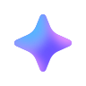

# [온보딩] 브랜드 취향 선택 — 인터랙션 정의

> 개발 전달용 인터랙션 명세입니다. 값은 MDS 모션 토큰(`src/common/mds-motion.css`) 기준입니다.
> 모션 라이브러리: **Motion** (motion.dev) — 웹 `motion`, React `motion/react`. 스프링 값은 두 환경 공통입니다.

- 프로토타입: `Type_1.html` (코드 블록 기준 버전 `20261115-30`, 홈 `20261115-15`)
- Figma: [작업-26-11](https://www.figma.com/design/C0XR68hLZmVbjQEOOqKCd0) — 브랜드 선택 284:148309 · 썸네일 284:148873 · 다이얼로그 295:151182 · 바텀시트 290:150996 · 로딩 299:151314 · 혜택 페이지 302:198803 · 취향 브랜드 모듈 304:201941
- 수정일: 2026-11-15 (로딩 썸네일 간격 · 타이틀 글자 모션 · 홈 헤더 접힘 · 추천 브랜드 화면 포커싱 확정 반영)
- 진행: 1차 브랜드 선택 화면 · 2차 로딩 화면 · **3차 혜택 페이지 · 무신사 홈** (전체 흐름 1차 정리 완료)
- ⚠️ **초안**: 프로토타입이 최종 확정되면 명세 전체(표 · 코드 블록)를 다시 검토하고 고칩니다.

### 읽는 법

- 각 절은 **표 = 기준값(플랫폼 공통)** → **코드 = 구현 참고(웹, 프로토타입에서 그대로)** 순서입니다.
- iOS · Android는 표를 기준으로 옮기고, 웹은 코드 블록을 그대로 써도 됩니다.
- 코드는 프로토타입 전용 장치(인덱스 옵션 · 자동 재생 · 화면 확인용 코드)를 뺀 모션 부분만 옮겼습니다.

---

## 0. 공통 규칙

| 항목 | 규칙 |
|---|---|
| 스프링 | **mass 1 · 시작 속도 0** 기준의 stiffness · damping (Motion `type: 'spring'`). duration 없음 — 끝나는 시점은 스프링 값으로 정해짐 |
| 플랫폼 변환 | iOS `UISpringTimingParameters(mass: 1, stiffness:, damping:, initialVelocity: .zero)` / Android Compose `spring()`은 dampingRatio · stiffness 방식이라 `dampingRatio = damping ÷ (2√stiffness)` 로 환산 |
| 중간에 끊길 때 | 진행 중인 모션이 있으면 **지금 값에서 이어서** 새 목표로 감 (처음 값으로 되돌리지 않음) |
| 기준점 | 따로 적지 않으면 **가운데** |
| 단위 | pt (375 기준) |
| 키프레임 이징 | 구간 이징은 **그 키프레임에서 다음 키프레임까지**에 적용 (예: "0%: A" = 0→다음 구간이 A) |
| 모션 줄이기 | OS 접근성 '동작 줄이기' 켜짐 → 반복 · 장식 모션(AI 아이콘, 배경 효과)은 정지 |

### 사용한 MDS 토큰

| 토큰 | 값 |
|---|---|
| `spring.normal` | stiffness 815 · damping 54 |
| `spring.bouncy` | stiffness 322 · damping 26 |
| `spring.elastic` | stiffness 550 · damping 24 |
| `spring.gentle` | stiffness 438 · damping 40 |
| `power3.easeOut` | cubic-bezier(0.22, 1, 0.36, 1) |
| `power2.easeInOut` | cubic-bezier(0.6, 0, 0.4, 1) |
| `power1.easeInOut` | cubic-bezier(0.33, 0, 0.67, 1) |
| `power3.easeInOut` | cubic-bezier(0.33, 0, 0.2, 1) |

```js
// 프로토타입: type_1.js — 모든 스프링 모션이 이 값을 씀
var MDS_SPRING = {
    normal: { type: 'spring', stiffness: 815, damping: 54 },
    bouncy: { type: 'spring', stiffness: 322, damping: 26 },
    elastic: { type: 'spring', stiffness: 550, damping: 24 },
    gentle: { type: 'spring', stiffness: 438, damping: 40 }
};
```

### 에셋

| 에셋 | 파일 (프로토타입) | 크기 | 비고 |
|---|---|---|---|
| AI 아이콘 | `src/img/IconAI.svg` | 18 (캡션) | Figma IconAI 컴포넌트 |
| 체크 아이콘 | 마크업 인라인 SVG (1-5 코드) | 28.2143 | 선 하나, `pathLength="1"` |
| 롱프레스 툴팁 | `src/img/tooltip_longPress.png` | 129 × 48 | 이미지 |
| 고정 글로우 | 마크업 인라인 SVG (1-2 코드) | 360 × 48 | 그라디언트 + blur 12.5 |
| 썸네일 | `src/img/thumb/` | 79 원 (로딩 64) | 프로토타입용 |
| AI 로딩 아이콘 | `src/components/IconAILoading/img-css/` (CSS + `IconAI.svg` 4장) | 32 | AI 렌즈와 같은 컴포넌트 원본 |

---

## 1. 브랜드 선택 화면

### 1-1. 화면 진입 (랜딩)

| 시점 | 무엇이 | 내용 |
|---|---|---|
| 0s | AI 배경 효과 (앱바 뒤) | 루핑 · 등장 섬광 · 고정 글로우 시작 (1-2) |
| 0s | 캡션 AI 아이콘 | 등장 모션 1회 → 이어서 루프 (1-3) |
| 0.5s | 롱프레스 툴팁 | 등장 (1-6) |

---

### 1-2. AI 배경 효과 (앱바 뒤 글로우)

앱바(타이틀 영역, 높이 80) 뒤 전체를 덮는 배경 효과. 세 층이 동시에 시작합니다. 화면 배경은 파스텔 그라디언트이고, 각 층의 "덮개"도 같은 배경색이라 앱바 아래에 경계가 생기지 않습니다.

**층 순서 (아래 → 위)**: 배경 → ① 루핑 그라디언트 → ② 등장 섬광 → ③ 고정 글로우 → 타이틀 글자

**화면 배경 (파스텔)**: linear-gradient(90deg, `#ECF0FB` 0%, `#F4F1F9` 51.923%, `#E9F6F9` 100%)

| 층 | 모션 | 값 |
|---|---|---|
| ① 루핑 그라디언트 | conic 그라디언트 시작 각도 0° → 360° 반복 | **3s · linear · 무한 반복**, 층 투명도 0.5 |
| | 색 (각도) | `#99ACFF` 0° → `#E476FF` 90° → `#659EFF` 180° → `#E3BCFF` 270° → `#99ACFF` 360° |
| | 덮개 (고정) | 위 **0** · 너비 150% · 높이 150%, blur 12 |
| ② 등장 섬광 (1회) | 스피너 회전 180° → 360° | **4s** · cubic-bezier(0, 0, 0.2, 1) |
| | 층 투명도 1 → 0 | **6s** · cubic-bezier(0, 0, 0.2, 1), 끝나면 사라진 채 유지 |
| | 스피너 | 앱바 너비·높이 중 큰 값의 110% 원, 투명도 0.5, blur 20 |
| | 색 (conic) | 배경색 0° → `#AF69FF` 30° → `#659EFF` 60° → `#47E6ED` 90° → 배경색 100° → 투명 360° |
| | 덮개 (고정) | 위 **20** · 너비 120% · 높이 150%, 모서리 25%, blur 16 |
| ③ 고정 글로우 (SVG) | 투명도 0 → 1 | **1s 대기 후 2s** · ease |
| | 크기 | 360 × **48** |

- 모션 줄이기에서는 ① ② 없이, ③만 바로 보임

```css
/* 프로토타입: type_1.css — 원본 값(덮개 0 · 20, 고정 글로우 48)으로 정리 */
:root {
  --page-bg-left: #ECF0FB;
  --page-bg-mid: #F4F1F9;
  --page-bg-right: #E9F6F9;
  --page-bg: linear-gradient(90deg, var(--page-bg-left) 0%, var(--page-bg-mid) 51.923%, var(--page-bg-right) 100%);
  --glow-periwinkle: #99ACFF;
  --glow-pink: #E476FF;
  --glow-sky: #659EFF;
  --glow-lavender: #E3BCFF;
  --glow-purple: #AF69FF;
  --glow-cyan: #47E6ED;
}
@property --glow-angle {
  syntax: '<angle>';
  initial-value: 0deg;
  inherits: false;
}
.gradient-effect {
  --effect-bg: var(--page-bg-mid); /* 스피너 conic 안의 바탕색 */
  container-type: size;
  position: absolute;
  inset: 0;
  z-index: 0;
  overflow: hidden;
  background: var(--page-bg);
  pointer-events: none;
}

/* ① 루핑 그라디언트: conic 시작 각도만 3초에 한 바퀴 */
.ambient-glow {
  position: absolute;
  inset: 0;
  z-index: 1;
  opacity: 0.5;
  background: conic-gradient(from var(--glow-angle) at 50% 50%,
    var(--glow-periwinkle) 0deg, var(--glow-pink) 90deg, var(--glow-sky) 180deg,
    var(--glow-lavender) 270deg, var(--glow-periwinkle) 360deg);
}
.ambient-glow::after { /* 배경 가림 (고정) */
  content: '';
  position: absolute;
  z-index: 10;
  top: 0;
  left: 50%;
  width: 150%;
  height: 150%;
  transform: translateX(-50%);
  background: linear-gradient(90deg, var(--page-bg-left) 16.667%, var(--page-bg-mid) 51.282%, var(--page-bg-right) 83.333%);
  filter: blur(12px);
}
@keyframes glowRotate {
  0%   {--glow-angle: 0deg;}
  100% {--glow-angle: 360deg;}
}
.gradient-effect.is-active .ambient-glow {animation: glowRotate 3s linear infinite;}

/* ② 등장 섬광 1회: 스피너 180° → 360° (4s), 전체 6s 페이드 아웃 */
.entrance-glow {
  position: absolute;
  inset: 0;
  z-index: 2;
  overflow: hidden;
  opacity: 0;
}
.entrance-glow::after { /* 배경 가림 (고정) */
  content: '';
  position: absolute;
  z-index: 10;
  top: 20px;
  left: 50%;
  width: 120%;
  height: 150%;
  transform: translateX(-50%);
  border-radius: 25%;
  background: linear-gradient(90deg, var(--page-bg-left) 8.333%, var(--page-bg-mid) 51.602%, var(--page-bg-right) 91.667%);
  filter: blur(16px);
}
.entrance-glow-spinner {
  position: absolute;
  top: 50%;
  left: 50%;
  z-index: 2;
  width: 110cqmax; /* 너비·높이 중 큰 값의 110% */
  aspect-ratio: 1 / 1;
  translate: -50% -50%;
  transform: rotate(180deg);
  border-radius: 50%;
  opacity: 0.5;
  filter: blur(20px);
  background: conic-gradient(
    var(--effect-bg) 0deg, var(--glow-purple) 30deg, var(--glow-sky) 60deg,
    var(--glow-cyan) 90deg, var(--effect-bg) 100deg, rgb(from var(--effect-bg) r g b / 0) 360deg);
}
@keyframes glowFadeOut {
  0%   {opacity: 1;}
  100% {opacity: 0;}
}
@keyframes glowSpin {
  0%   {transform: rotate(180deg);}
  100% {transform: rotate(360deg);}
}
.gradient-effect.is-active .entrance-glow {animation: glowFadeOut 6s cubic-bezier(0, 0, 0.2, 1) forwards;}
.gradient-effect.is-active .entrance-glow-spinner {animation: glowSpin 4s cubic-bezier(0, 0, 0.2, 1) forwards;}

/* ③ 고정 SVG 글로우: 1초 대기 후 2초 페이드 인 */
.static-glow {
  display: block;
  position: relative;
  z-index: 3;
  width: 360px;
  height: 48px;
  opacity: 0;
}
@keyframes glowFadeIn {
  0%   {opacity: 0;}
  100% {opacity: 1;}
}
.gradient-effect.is-active .static-glow {animation: glowFadeIn 2s ease 1s forwards;}

@media (prefers-reduced-motion: reduce) {
  .gradient-effect.is-active .ambient-glow,
  .gradient-effect.is-active .entrance-glow,
  .gradient-effect.is-active .entrance-glow-spinner,
  .gradient-effect.is-active .static-glow {animation: none;}
  .entrance-glow {opacity: 0;}
  .static-glow {opacity: 1;}
}
```

```html
<!-- 프로토타입: Type_1.html — 앱바 안 -->
<div class="gradient-effect is-active" aria-hidden="true">
  <div class="ambient-glow"></div>
  <div class="entrance-glow"><div class="entrance-glow-spinner"></div></div>
  <svg class="static-glow" width="360" height="48" viewBox="0 0 360 48" fill="none" preserveAspectRatio="none">
    <g clip-path="url(#staticGlowClip)">
      <path d="M-74 -14H341L323.214 3.51948L136.464 24L-36.65 6.72727L-74 -14Z" fill="url(#staticGlowGradient)" filter="url(#staticGlowBlur)"/>
    </g>
    <defs>
      <filter id="staticGlowBlur" x="-99" y="-39" width="465" height="88" filterUnits="userSpaceOnUse" color-interpolation-filters="sRGB">
        <feGaussianBlur stdDeviation="12.5"/>
      </filter>
      <linearGradient id="staticGlowGradient" x1="300.686" y1="-5.76667" x2="-11.1571" y2="-5.76668" gradientUnits="userSpaceOnUse">
        <stop stop-color="#C2DAFF" stop-opacity="0.57"/>
        <stop offset="0.692308" stop-color="#CCC2FF" stop-opacity="0.5"/>
        <stop offset="0.908654" stop-color="#C2DAFF"/>
      </linearGradient>
      <clipPath id="staticGlowClip"><rect width="360" height="48" fill="white"/></clipPath>
    </defs>
  </svg>
</div>
```

---

### 1-3. AI 아이콘 (캡션 앞 반짝이)

랜딩 즉시 **등장 1회 → 이어서 루프**. 기준점은 가운데, 투명도는 바꾸지 않고 스케일 0에서 시작합니다. scale과 rotate는 **서로 다른 애니메이션 두 개**로 따로 돕니다 (루프 주기가 달라 하나로 합치면 안 됨).

**등장 (1.3s, 1회)**

| 속성 | 키프레임 | 이징 |
|---|---|---|
| scale | 0 (0%) → **1.2** (25%) → 1 (100%) | 0→25%: `power3.easeInOut` · 25→100%: `power1.easeInOut` |
| rotate | −140° (0%) → −20° (33%) → 0° (100%) | 0→33%: cubic-bezier(0.33, 0, 0.2, 0.8) · 33→100%: cubic-bezier(0.5, 1, 0.36, 1) |

> rotate 곡선 2개는 이 아이콘 전용 값입니다 (MDS 토큰 아님).

**루프 (등장의 rotate가 끝나는 순간 시작, 무한 반복)**

| 속성 | 주기 | 키프레임 | 이징 |
|---|---|---|---|
| scale | **3.5s** | 1 (0%) → 0.8 (25%) → 1.2 (75%) → 1 (100%) | `power1.easeInOut` |
| rotate | **12s** | 0° (0%) → 115° (16.67%) → 90° (33.33%) → 0° (50%) → 0° (66.67%, 정지) → −30° (83.33%) → 0° (100%) | 0% · 66.67% 구간: `power2.easeInOut`, 그 외 `power1.easeInOut` |

- 등장 끝 상태(scale 1 · 0°)와 루프 시작 값이 같아서 이어 붙여도 튀지 않음
- 두 주기(3.5s · 12s)는 일부러 나누어떨어지지 않게 둠 (반복 인상 줄이기)
- 바텀시트 제목의 AI 아이콘도 같은 모션 — 시트가 열릴 때마다 등장부터 다시
- 모션 줄이기 설정에서는 정지

```css
/* 프로토타입: type_1.css */
.ai-icon {
  transform-origin: center;
  scale: 1;
  rotate: 0deg;
}
.ai-icon.is-entrance {
  animation: aiEntranceScale 1.3s forwards, aiEntranceRotate 1.3s forwards;
}
.ai-icon.is-loop {
  animation: aiLoopScale 3.5s var(--mds-motion-power1-easeInOut) infinite,
             aiLoopRotate 12s var(--mds-motion-power1-easeInOut) infinite;
}
@keyframes aiEntranceScale {
  0%   {scale: 0;   animation-timing-function: var(--mds-motion-power3-easeInOut);}
  25%  {scale: 1.2; animation-timing-function: var(--mds-motion-power1-easeInOut);} /* 오버슈트 */
  100% {scale: 1;}
}
@keyframes aiEntranceRotate {
  0%   {rotate: -140deg; animation-timing-function: cubic-bezier(0.33, 0, 0.2, 0.8);}
  33%  {rotate: -20deg;  animation-timing-function: cubic-bezier(0.5, 1, 0.36, 1);} /* 오버슈트 */
  100% {rotate: 0deg;}
}
@keyframes aiLoopScale {
  0%   {scale: 1;}
  25%  {scale: 0.8;}
  75%  {scale: 1.2;}
  100% {scale: 1;}
}
@keyframes aiLoopRotate {
  0%     {rotate: 0deg;   animation-timing-function: var(--mds-motion-power2-easeInOut);}
  16.67% {rotate: 115deg;}
  33.33% {rotate: 90deg;}  /* 115 → 90 오버슈트 */
  50%    {rotate: 0deg;}
  66.67% {rotate: 0deg;   animation-timing-function: var(--mds-motion-power2-easeInOut);} /* 50~66.67% 정지 */
  83.33% {rotate: -30deg;}
  100%   {rotate: 0deg;}
}
@media (prefers-reduced-motion: reduce) {
  .ai-icon.is-entrance, .ai-icon.is-loop {animation: none;}
}
```

```js
// 프로토타입: type_1.js — 등장(rotate)이 끝나면 루프로 전환
icon.addEventListener('animationend', function (e) {
    if (e.target !== icon || e.animationName !== 'aiEntranceRotate' || !icon.classList.contains('is-entrance')) return;
    icon.classList.replace('is-entrance', 'is-loop');
});
```

```html
<span class="brand-caption-icon ai-icon is-entrance"></span>
```

---

### 1-4. 썸네일 누름 판정 (다운 · 업 · 롱프레스)

| 이벤트 | 조건 |
|---|---|
| 다운 | 손가락(또는 마우스 왼쪽)을 댐 |
| 탭 (클릭) | 짧게 누르고 뗌 → 선택 / 해제 (1-5) |
| 롱프레스 | **0.5s** 이상 누름 → 바텀시트 (1-11). 이후 떼도 탭으로 처리하지 않음 |
| 취소 | **10px** 넘게 움직임 (스크롤로 판단) · 스크롤 시작 · 손가락이 버튼 밖으로 나감 → 탭·롱프레스 모두 아님 |

**누름 스케일**

| 시점 | 대상 | 값 |
|---|---|---|
| 다운 | 썸네일 원 (기준점 가운데) | scale 1 → **0.9** · `spring.normal` |
| 업 · 취소 · 롱프레스 후 뗌 | 썸네일 원 | scale → **1** · `spring.normal` (지금 값에서 이어서) |

```js
// 프로토타입: type_1.js — 판정 (요약: 다운 → 0.5초 타이머 = 롱프레스, 10px 이동 = 취소, 롱프레스가 아니면 뗄 때 탭)
var LONG_PRESS = 500;    // 롱프레스 인정 시간 (ms)
var MOVE_TOLERANCE = 10; // 이만큼 움직이면 누름 취소 (스크롤로 봄)

function onDown(e) {
    if (e.button !== undefined && e.button !== 0) return; // 마우스 왼쪽·터치만
    if (press) end(null, false);
    var button = e.currentTarget;
    press = { button: button, pointerId: e.pointerId, x: e.clientX, y: e.clientY, long: false, timer: null };
    press.timer = setTimeout(function () {
        if (!press || press.button !== button) return;
        press.long = true;
        emit('longpress', button, e);
    }, LONG_PRESS);
    emit('down', button, e);
}
function onMove(e) {
    if (!press || e.pointerId !== press.pointerId) return;
    if (Math.abs(e.clientX - press.x) > MOVE_TOLERANCE || Math.abs(e.clientY - press.y) > MOVE_TOLERANCE) end(e, false);
}
function end(e, isUp) {
    if (!press || (e && e.pointerId !== press.pointerId)) return;
    var done = press;
    press = null;
    clearTimeout(done.timer);
    emit('release', done.button, e);
    if (isUp && !done.long) emit('click', done.button, e);
}
// pointerdown → onDown, pointermove → onMove, pointerup → end(e, true), pointercancel → end(e, false)

// 누름 스케일
thumbPress.on('down', function (button) {
    Motion.animate(button.querySelector('.brand-thumb'), { scale: 0.9 }, MDS_SPRING.normal);
});
thumbPress.on('release', function (button) {
    Motion.animate(button.querySelector('.brand-thumb'), { scale: 1 }, MDS_SPRING.normal);
});
```

```css
/* 롱프레스 중 글자 선택 · 확대 대기 막기 */
.brand-button {
  -webkit-tap-highlight-color: transparent;
  -webkit-user-select: none;
  user-select: none;
  -webkit-touch-callout: none;
  touch-action: manipulation;
}
```

---

### 1-5. 브랜드 선택 / 해제

탭할 때마다 선택 ↔ 해제. 선택한 순서를 기억합니다 (타이틀 · 로딩 썸네일 순서에 사용).

**선택 (Figma 284:148873)**

| 대상 | 모션 | 값 |
|---|---|---|
| 딤 (검정 40% 원, 썸네일 크기, 기준점 가운데) | scale 0 → 1 | **0.3s** · `power3.easeOut` |
| 체크 아이콘 (28, x25.5 · y25) | 선 그리기 0 → 100% | **0.3s** · `power2.easeInOut` · 딜레이 없음 |
| | scale 1.5 → 1 (기준점 가운데) | 위와 동시에 |
| | 선 굵기 4 → 2 | 위와 동시에 |

**해제**: 딤 · 체크 모두 모션 없이 바로 사라짐

> 선 그리기: 경로 길이를 1로 두고(`pathLength="1"`) `stroke-dashoffset` 1 → 0.

```css
/* 프로토타입: type_1.css */
.brand-thumb {position: relative;}
.brand-dim {
  position: absolute;
  inset: 0;
  border-radius: 50%;
  background: rgba(0, 0, 0, 0.4);
  transform: scale(0);
  pointer-events: none;
}
.brand-check {
  position: absolute;
  top: calc(25px + 14px - 14.107px);  /* 28 칸(x25.5 y25) 가운데에 28.2143 아이콘 */
  left: calc(25.5px + 14px - 14.107px);
  display: block;
  overflow: visible;
  transform-origin: 50% 50%;
  pointer-events: none;
}
.brand-check path {
  stroke-linecap: butt;
  stroke-dasharray: 1;    /* pathLength="1" 기준: 선 전체 길이 = 1 */
  stroke-dashoffset: 1;   /* 처음엔 다 지워진 상태 */
}
/* 선택(.is-selected)되면 등장, 해제되면 클래스가 빠지면서 바로 사라짐 */
.brand-button.is-selected .brand-dim {
  animation: brandDimIn 0.3s var(--mds-motion-power3-easeOut) both;
}
@keyframes brandDimIn {
  from {transform: scale(0);}
  to   {transform: scale(1);}
}
.brand-button.is-selected .brand-check {
  animation: brandCheckScale 0.3s var(--mds-motion-power2-easeInOut) both;
}
.brand-button.is-selected .brand-check path {
  animation: brandCheckDraw 0.3s var(--mds-motion-power2-easeInOut) both;
}
@keyframes brandCheckScale {
  from {transform: scale(1.5);}
  to   {transform: scale(1);}
}
@keyframes brandCheckDraw {
  from {stroke-dashoffset: 1; stroke-width: 4px;}
  to   {stroke-dashoffset: 0; stroke-width: 2px;}
}
```

```html
<!-- 썸네일 안 -->
<span class="brand-thumb">
  
  <span class="brand-dim"></span>
  <svg class="brand-check" width="28.2143" height="28.2143" viewBox="0 0 28.2143 28.2143" fill="none">
    <path d="M4.9375 12.6964L11.7707 19.5297C11.8913 19.6503 12.0877 19.6473 12.2046 19.5231L23.2768 7.75893" stroke="white" stroke-width="2" pathLength="1"/>
  </svg>
</span>
```

---

### 1-6. 롱프레스 툴팁

"길게 누르면…" 안내 툴팁 (첫 화면 7번째 썸네일 위 4, 가운데 정렬, 129 × 48 이미지).

| 항목 | 값 |
|---|---|
| 등장 시점 | 랜딩 **0.5s** 후 |
| 등장 | scale 0.75 → 1 · `spring.elastic` + 투명도 0 → 1 **0.1s linear** (동시) |
| 기준점 | 하단 가운데 (말꼬리 끝) |
| 유지 | 등장 후 **5s** |
| 퇴장 | scale 1 → 0.75 · `spring.elastic` + 투명도 1 → 0 **0.1s linear** |

**사라지는 조건** (먼저 일어난 것 하나, 한 번 사라지면 다시 나오지 않음)
- 5s 경과
- 툴팁 탭
- 스크롤해서 툴팁 윗선이 상태바 아래 **85** 안으로 들어옴
- 아무 썸네일이나 롱프레스
- 아무 썸네일이나 선택 (해제는 해당 없음)

```css
.longpress-tooltip {
  position: absolute;
  top: -52px;              /* 툴팁 높이 48 + 간격 4 */
  left: 50%;
  margin-left: -64.5px;    /* 너비 129의 절반 — transform은 스케일 모션에 씀 */
  transform-origin: 50% 100%;
  opacity: 0;
  transform: scale(0.75);
}
```

```js
// 프로토타입: type_1.js — 스케일(스프링)과 페이드(0.1s linear)를 동시에
function play(scaleTo, opacityTo) {
    Motion.animate(tooltip, { scale: scaleTo }, MDS_SPRING.elastic);
    Motion.animate(tooltip, { opacity: opacityTo }, { duration: 0.1, ease: 'linear' });
}
// 등장: 랜딩 0.5초 후 play(1, 1) → 5초 후 play(0.75, 0)
```

---

### 1-7. 추천 브랜드 등장

브랜드를 **선택**하면 비슷한 브랜드 3개가 그 썸네일 바로 뒤에 들어옵니다.

- 썸네일 하나당 한 번만 (해제 후 다시 선택해도 다시 들어오지 않음)
- 추천으로 들어온 브랜드를 선택하면 그 뒤에 또 3개
- 해제해도 들어온 추천 브랜드는 남음

| 대상 | 모션 | 값 |
|---|---|---|
| 기존 썸네일 | 원래 자리 → 밀려난 새 자리 (FLIP) | `spring.normal` · 선택 즉시 |
| 새 썸네일 3개 | scale 0 → 1 | **0.2s 후 시작, 0.1s 간격** · 1·2번째 `spring.normal`, 3번째 `spring.bouncy` |
| | 투명도 0 → 1 | 각각 같은 시작 시점에 **0.2s linear** |
| 리스트 스크롤 (화면 포커싱) | 새 썸네일 3개가 **모두 보이도록** 필요한 만큼만 스크롤 | **0.4s** · `power3.easeInOut` · 선택 즉시 (밀림과 동시) |

**화면 포커싱 규칙**
- 보이는 영역: 앱바 아래 ~ **하단 버튼 영역 위**, 여백 **16**
- 새 썸네일 3개 중 하나라도 이 영역 밖(아래로 하단 버튼에 가려짐 / 위로 앱바에 가려짐)이면, 3개 전체가 영역 안에 들어오는 위치까지 스크롤
- 이미 모두 보이면 스크롤하지 않음
- 새 썸네일 등장(0.2s 뒤 시작)은 스크롤 도중 화면 안에서 보임
- 자동 스크롤 중 사용자가 만지거나 스크롤하면 그 자리에서 멈춤

> 프로토타입은 데이터가 없어 기존 20개 중 무작위 3개를 씁니다 (실서비스는 추천 결과).

```js
// 프로토타입: type_1.js
var ENTER = [MDS_SPRING.normal, MDS_SPRING.normal, MDS_SPRING.bouncy];
var ENTER_DELAY = 0.2;   // 기존 썸네일이 밀리기 시작하고 나서
var STAGGER = 0.1;
var FADE = 0.2;

/* FLIP: 넣기 전 위치를 기억 → 넣은 뒤 새 위치와의 차이만큼 되돌려 놓고 0으로 */
var items = [].slice.call(grid.querySelectorAll('.brand-item'));
var before = items.map(function (li) { return li.getBoundingClientRect(); });
/* … 새 칸 3개를 누른 칸 바로 뒤에 넣음 (opacity 0, scale 0 상태로) … */
items.forEach(function (li, i) {
    var now = li.getBoundingClientRect();
    var dx = before[i].left - now.left;
    var dy = before[i].top - now.top;
    if (dx || dy) Motion.animate(li, { x: [dx, 0], y: [dy, 0] }, MDS_SPRING.normal);
});
focusItems(added); // 새 칸 3개가 화면 안에서 등장하도록 (밀림과 동시)
added.forEach(function (li, i) {
    var delay = ENTER_DELAY + STAGGER * i;
    Motion.animate(li, { scale: [0, 1] }, Object.assign({ delay: delay }, ENTER[i]));
    Motion.animate(li, { opacity: [0, 1] }, { duration: FADE, ease: 'linear', delay: delay });
});

/* 화면 포커싱: 새 칸들이 보이는 영역(앱바 아래 ~ 하단 버튼 위, 여백 16) 안에 들어오도록 스크롤 */
var FOCUS_MARGIN = 16;
var FOCUS_SCROLL = { duration: 0.4, ease: [0.33, 0, 0.2, 1] }; // mds power3.easeInOut
function focusItems(items) {
    /* 레이아웃 위치(스크롤 내용 기준). 새 칸은 scale(0)이라 offsetTop으로 잼 */
    var top = Math.min.apply(null, items.map(function (li) { return li.offsetTop; }));
    var bottom = Math.max.apply(null, items.map(function (li) { return li.offsetTop + li.offsetHeight; }));
    var areaRect = scrollArea.getBoundingClientRect();
    var visibleH = bottomBar.getBoundingClientRect().top - areaRect.top;
    var from = scrollArea.scrollTop, target = from;
    if (bottom > from + visibleH - FOCUS_MARGIN) target = bottom - visibleH + FOCUS_MARGIN; // 아래로 가려짐 → 올림
    else if (top < from + FOCUS_MARGIN) target = top - FOCUS_MARGIN;                       // 위로 가려짐 → 내림
    target = Math.max(0, Math.min(scrollArea.scrollHeight - scrollArea.clientHeight, target));
    if (Math.abs(target - from) < 1) return;                                                // 이미 보이면 그대로
    focusRun = Motion.animate(from, target, Object.assign({
        onUpdate: function (v) { scrollArea.scrollTop = v; }
    }, FOCUS_SCROLL));
}
// 사용자가 만지면 멈춤
scrollArea.addEventListener('touchstart', stopFocus, { passive: true });
scrollArea.addEventListener('wheel', stopFocus, { passive: true });
```

---

### 1-8. 타이틀 · 하단 버튼 문구 (선택 수에 따라)

| 선택 수 | 타이틀 1줄째 | 타이틀 2줄째 | 하단 버튼 |
|---|---|---|---|
| 0개 | 관심 있는 브랜드를 선택해 주세요. | 취향에 맞는 상품을 추천해 드립니다. | 브랜드를 선택해 주세요 (기본색) |
| 1개 | **[커버낫]**을 선택했습니다. | 또 관심 있는 브랜드가 있나요? | N개 선택하고 추천받기 (파랑) |
| 2~3개 | **[커버낫 외 N개]** 브랜드를 선택했습니다. | 〃 | 〃 |
| 4개 이상 | **[N개]** 브랜드를 선택했습니다. | 〃 | 〃 |

- [ ] 안은 강조색(파랑 `#334CFF`)
- 이름은 지금 선택된 것 중 **가장 먼저 고른 브랜드**
- 을·를은 브랜드명 받침에 따라 자동
- 긴 브랜드명: 1줄째가 한 줄에 들어가도록 **브랜드명만** 뒤를 "…"로 자름 ("외 N개"와 문장 끝은 그대로)
- 문구 변경은 모션 없이 바로 바뀜

---

### 1-9. 스낵바 — 선택 없이 하단 버튼을 누름

MDS 2.5 Snackbar 인터랙션 정의를 따름. 문구: "브랜드를 1개 이상 선택해 주세요." / 위치: 하단 버튼 위 (화면 하단에서 102).

| 항목 | 값 |
|---|---|
| 등장 | 위치: 자기 높이만큼 아래 → 제자리 · `spring.bouncy` / 투명도 0 → 1 · **0.15s linear** (동시) |
| 유지 | 등장 **완료** 시점부터 **3s** 후 자동 퇴장 |
| 퇴장 | 등장의 역행 (위치 → 자기 높이만큼 아래 `spring.bouncy` / 투명도 1 → 0 0.15s linear) |
| 드래그 | 아래로만, 손가락 1:1, 자기 높이까지만 (러버밴드 없음), 투명도 1 유지, 드래그 중엔 자동 퇴장 대기 멈춤 |
| 드래그 놓음 | 자기 높이의 **50%** 이상 → 퇴장 / 미만 → 제자리로 `spring.bouncy` 후 3s 다시 대기 |
| 연속 누름 | 떠 있는 동안 다시 누르면 무시 (가이드에 정의 없음, 2026-11-14 결정) |

```js
// 프로토타입: type_1.js (요약)
var FADE = { duration: 0.15, ease: 'linear' };
var HOLD = 3000;          // 등장 완료 후 자동 퇴장까지
var DISMISS_RATIO = 0.5;  // 드래그 퇴장 판정선 (자기 높이의 50%)

// 등장: 시작 위치(자기 높이만큼 아래) + 투명 상태를 먼저 잡고 → 위치 · 투명도 동시에
bar.style.transform = 'translateY(' + bar.offsetHeight + 'px)';
Motion.animate(bar, { y: [bar.offsetHeight, 0] }, MDS_SPRING.bouncy)
    .then(function () { holdTimer = setTimeout(hide, HOLD); }); // 등장 완료 시점부터 3초
Motion.animate(bar, { opacity: [0, 1] }, FADE);

// 퇴장
Motion.animate(bar, { y: [current, bar.offsetHeight] }, MDS_SPRING.bouncy);
Motion.animate(bar, { opacity: [1, 0] }, FADE);

// 드래그 중: y = clamp(시작 오프셋 + 이동량, 0, 자기 높이) 를 즉시 적용 (duration 0)
// 놓을 때: y >= 높이 × 0.5 → 퇴장 / 아니면 y → 0 (spring.bouncy) 후 다시 3초 대기
```

---

### 1-10. 다이얼로그 — "다음에 할게요"

Figma 295:151182. 다이얼로그 인터랙션 가이드(2026-11-14 전달).

| 대상 | 등장 | 퇴장 |
|---|---|---|
| 다이얼로그 | scale **1.06 → 1** + 투명도 0 → 1 · `spring.normal` | scale 1 그대로 + 투명도 1 → 0 · `spring.normal` |
| 딤 (검정 60%) | 투명도 0 → 1 · **0.15s linear** | 투명도 1 → 0 · 0.15s linear |

- 닫기: 딤 · 다이얼로그 · 버튼 어디를 눌러도 닫힘 (프로토타입은 버튼 동작 연결 없음)
- 딤 이징은 가이드에 없어 다른 딤과 같은 0.15s linear로 둠

```js
// 프로토타입: type_1.js
var DIM_FADE = { duration: 0.15, ease: 'linear' };
// 등장 (시작 상태를 먼저: dim 0, box opacity 0 · scale 1.06)
Motion.animate(dim, { opacity: [0, 1] }, DIM_FADE);
Motion.animate(box, { scale: [1.06, 1], opacity: [0, 1] }, MDS_SPRING.normal);
// 퇴장 (스케일은 1 그대로)
Motion.animate(dim, { opacity: [1, 0] }, DIM_FADE);
Motion.animate(box, { opacity: [1, 0] }, MDS_SPRING.normal);
```

---

### 1-11. 바텀시트 — 썸네일 롱프레스

Figma 290:150996 (프로토타입은 어떤 썸네일이든 어나더오피스 내용).

| 대상 | 등장 | 퇴장 |
|---|---|---|
| 시트 | 자기 높이만큼 아래 → 제자리 · `spring.gentle` | 제자리 → 자기 높이만큼 아래 · `spring.gentle` |
| 딤 (검정 60%) | 투명도 0 → 1 · **0.15s linear** | 투명도 1 → 0 · 0.15s linear |
| 제목 AI 아이콘 | 열릴 때마다 등장 → 루프 (1-3과 같음) | — |

- 등장 · 퇴장 모두 `spring.gentle` (시스템 가이드)
- 닫기: 딤 탭 또는 닫기(X)

```js
// 프로토타입: type_1.js
var DIM_FADE = { duration: 0.15, ease: 'linear' };
// 등장 (시작 상태를 먼저: dim 0, sheet translateY(100%))
var h = sheet.offsetHeight;
Motion.animate(dim, { opacity: [0, 1] }, DIM_FADE);
Motion.animate(sheet, { y: [h, 0] }, MDS_SPRING.gentle);
icon.classList.remove('is-entrance', 'is-loop'); void icon.offsetWidth; icon.classList.add('is-entrance'); // AI 아이콘 다시 등장
// 퇴장
Motion.animate(dim, { opacity: [1, 0] }, DIM_FADE);
Motion.animate(sheet, { y: [0, sheet.offsetHeight] }, MDS_SPRING.gentle);
```

---

## 2. 로딩 화면

Figma 299:151314. 브랜드를 1개 이상 선택하고 하단 버튼("N개 선택하고 추천받기")을 누르면 나옵니다.

### 2-1. 진입 · 노출 · 퇴장

| 항목 | 값 |
|---|---|
| 진입 | 하단 버튼을 누르면 **전환 모션 없이 바로** 로딩 화면이 브랜드 선택 화면을 덮음 (상태바 아래 전체, 화면 배경과 같은 파스텔) |
| 노출 시간 | 조건: **최소 3초 노출**. 실서비스는 3초가 지나고 추천 결과가 오면 넘어감 (둘 중 늦은 쪽) |
| | 프로토타입: 인덱스 옵션 '로딩 화면 노출 시간' 3~8초 (0.5초 단위, 기본 5초) |
| 퇴장 | 혜택 페이지로 **새 페이지 이동** (3절) |
| 뒤로 돌아왔을 때 | 로딩 화면은 다시 나오지 않음 — 처음 상태의 브랜드 선택 화면 (3절) |

### 2-2. 브랜드 썸네일 등장

선택한 순서대로 **최대 3개**. 64 원 + 흰 테두리 3, 16씩 겹침, **뒤에 선택한 것이 위**.

한 개씩 묶음 끝에 붙고 **묶음은 늘 화면 가운데** — 첫 썸네일은 가운데에서 나오고, 다음 썸네일이 붙을 때 앞의 것들이 새 자리로 밀려남.

| 대상 | 모션 | 값 |
|---|---|---|
| 새 썸네일 | scale 0 → 1 | 마지막 썸네일만 `spring.bouncy`, 나머지 `spring.normal` |
| | 투명도 0 → 1 | **0.2s linear** (scale과 동시) |
| 앞의 썸네일 | 원래 자리 → 밀려난 새 자리 (FLIP, 가로) | `spring.normal` · 새 썸네일이 붙는 순간 |
| 간격 | **0.2s** (개수와 상관없이) | 첫 썸네일은 화면이 나오는 순간(0s) |

### 2-3. 타이틀 "취향이 분명하시네요!"

| 항목 | 값 |
|---|---|
| 시작 | **마지막 썸네일이 나오기 시작하고 0.2s 뒤** |
| 글자 (취 ~ 요) | 위치 Y: **6** 아래 → 제자리 · `spring.bouncy` + 투명도 0 → 1 · **0.2s linear** (동시). 마스크 없이 그대로 보이며 올라옴 |
| 글자 간격 | **0.04s** (공백은 간격을 차지하지 않음) |
| "!" | 마지막 글자 "요"가 **시작하고 0.1s 뒤**, 제자리에서 scale 0 → 1 · `spring.elastic` · 기준점 **하단 가운데** |
| 설명 문구 · 하단 안내 | 모션 없음 (바로 보임) |

**시작 시점 (화면이 나온 순간 = 0s)**

| 썸네일 수 | 썸네일 | 타이틀 "취" | "요" | "!" |
|---|---|---|---|---|
| 1개 | 0 | 0.2s | 0.52s | 0.62s |
| 2개 | 0 · 0.2s | 0.4s | 0.72s | 0.82s |
| 3개 | 0 · 0.2 · 0.4s | 0.6s | 0.92s | 1.02s |

### 2-4. AI 로딩 아이콘

AI 렌즈에서 쓰는 IconAILoading 컴포넌트 원본 (IMG + CSS). 32 크기, **한 바퀴 1.8s · linear · 무한 반복**. 반짝이 4개가 서로 다른 위치 · 크기 키프레임으로 돌아가며 나타났다 사라짐. 값은 아래 CSS가 기준입니다 (컴포넌트 원본 그대로, 고치지 않음).

```js
// 프로토타입: type_1_loading.js
var STAGGER = 0.2;      // 썸네일 간격 (개수와 상관없이)
var FADE = 0.2;
var TITLE_GAP = 0.2;    // 마지막 썸네일 시작 → 타이틀 시작
var CHAR_STAGGER = 0.04;// 글자 간격
var BANG_GAP = 0.1;     // "요" 시작 → "!" 시작
var CHAR_RISE = 6;      // 글자가 올라오는 거리 (px)
var CHAR_FADE = { duration: 0.2, ease: 'linear' }; // 글자 투명도 0 → 1

/* 썸네일: 차례가 되면 묶음 끝에 붙임 → 앞의 것들은 원래 자리 → 새 자리로 (FLIP) */
function addThumb(item, isLast) {
    var before = [].map.call(stack.children, function (el) { return el.getBoundingClientRect().left; });
    stack.appendChild(item);                    // item은 opacity 0 · scale 0 상태로 만들어 둠
    [].forEach.call(stack.children, function (el, i) {
        if (el === item) return;
        var dx = before[i] - el.getBoundingClientRect().left;
        if (dx) Motion.animate(el, { x: [dx, 0] }, MDS_SPRING.normal);
    });
    Motion.animate(item, { scale: [0, 1] }, isLast ? MDS_SPRING.bouncy : MDS_SPRING.normal);
    Motion.animate(item, { opacity: [0, 1] }, { duration: FADE, ease: 'linear' });
}
function playThumbs(items) {
    items.forEach(function (item, i) {
        setTimeout(function () { addThumb(item, i === items.length - 1); }, STAGGER * i * 1000);
    });
}

/* 타이틀: 글자마다 span (공백도 한 칸). 글자는 Y 위치(bouncy) + 페이드 인, "!"만 스케일(elastic) */
function playTitle(count) {
    title.classList.add('is-rise');
    var rise = CHAR_RISE;                                         // 6 아래에서
    var lastThumbAt = Math.max(count - 1, 0) * STAGGER;
    var delay = lastThumbAt + TITLE_GAP;
    chars.forEach(function (span, i) {
        var isBang = i === chars.length - 1;
        var isSpace = span.textContent === ' ';
        if (i > 0 && !isSpace) delay += isBang ? BANG_GAP : CHAR_STAGGER; // 공백은 간격 없음
        if (isBang) {
            span.style.transform = 'scale(0)';
            Motion.animate(span, { scale: [0, 1] }, Object.assign({ delay: delay }, MDS_SPRING.elastic));
        } else {
            span.style.transform = 'translateY(' + rise + 'px)';
            span.style.opacity = '0';
            Motion.animate(span, { y: [rise, 0] }, Object.assign({ delay: delay }, MDS_SPRING.bouncy));
            Motion.animate(span, { opacity: [0, 1] }, Object.assign({ delay: delay }, CHAR_FADE));
        }
    });
}

/* 노출 시간: 최소 3초 */
var LOADING_HOLD_MIN = 3000;
```

```css
/* 프로토타입: type_1.css */
.loading-thumb {
  width: 64px;
  height: 64px;
  border-radius: 50%;
  overflow: hidden;
  box-shadow: 0 0 0 3px #fff;
}
.loading-thumb + .loading-thumb {margin-left: -16px;}  /* 뒤에 붙는 것이 위 (DOM 순서) */
.loading-title {font-size: 18px; font-weight: 600; line-height: 24px;}
.loading-char {display: inline-block; transform-origin: 50% 100%;}
.loading-title.is-rise .loading-char:last-child {transform-origin: 50% 100%;} /* "!": 하단 중앙 기준 */
.loading-icon {--IconAILoading-size: 32px; --IconAILoading-time: 1.8s; position: relative; width: 32px; height: 32px;}
```

```css
/* 컴포넌트 원본: src/components/IconAILoading/img-css/icon-ai-loading-img.css */
.IconAILoading {
    --icon-size: var(--IconAILoading-size, 32px);
    position: absolute; top: 50%; left: 50%;
    width: var(--icon-size);
    height: var(--icon-size);
    transform: translate(-50%, -50%);
}
.IconAILoading[hidden] { display: none; }
.IconAILoading > span { position: absolute; inset: 0; }
.IconAILoading img { display: block; width: 100%; height: 100%; }

.IconAILoading.is-playing > span,
.IconAILoading.is-playing img {
    animation-duration: var(--IconAILoading-time, 1.8s);
    animation-timing-function: linear;
    animation-iteration-count: infinite;
    animation-fill-mode: both;
}

.IconAILoading > span:nth-child(1) { translate: 0% 0%; }
.IconAILoading > span:nth-child(1) img { scale: 1.05; }
.IconAILoading > span:nth-child(2) { translate: -32.42% -27.34%; }
.IconAILoading > span:nth-child(2) img { scale: 0; }
.IconAILoading > span:nth-child(3) { translate: -24.22% 3.12%; }
.IconAILoading > span:nth-child(3) img { scale: 0; }
.IconAILoading > span:nth-child(4) { translate: -12.24% -36.57%; }
.IconAILoading > span:nth-child(4) img { scale: 0; }

.IconAILoading.is-playing > span:nth-child(1) { animation-name: icon-ai-loading-img-position1; }
.IconAILoading.is-playing > span:nth-child(1) img { animation-name: icon-ai-loading-img-scale1; }
.IconAILoading.is-playing > span:nth-child(2) { animation-name: icon-ai-loading-img-position2; }
.IconAILoading.is-playing > span:nth-child(2) img { animation-name: icon-ai-loading-img-scale2; }
.IconAILoading.is-playing > span:nth-child(3) { animation-name: icon-ai-loading-img-position3, icon-ai-loading-img-opacity3; }
.IconAILoading.is-playing > span:nth-child(3) img { animation-name: icon-ai-loading-img-scale3; }
.IconAILoading.is-playing > span:nth-child(4) { animation-name: icon-ai-loading-img-position4-x, icon-ai-loading-img-position4-y; }
.IconAILoading.is-playing > span:nth-child(4) img { animation-name: icon-ai-loading-img-scale4; }

@keyframes icon-ai-loading-img-position1 {
    0% { translate: 0% 0%; }
    45.37%, 100% { translate: 35.74% 35.74%; }
}
@keyframes icon-ai-loading-img-scale1 {
    0% { scale: 1.05; animation-timing-function: cubic-bezier(0.438, -0.008, 0.667, 0.483); }
    34.26% { scale: 0.25; animation-timing-function: cubic-bezier(0.24, 0.387, 0.667, 1); }
    45.37%, 100% { scale: 0; }
}
@keyframes icon-ai-loading-img-position2 {
    0%, 3.7% { translate: -32.42% -27.34%; animation-timing-function: cubic-bezier(0.178, 0, 0.801, 1); }
    75%, 100% { translate: 29.69% 26.56%; }
}
@keyframes icon-ai-loading-img-scale2 {
    0%, 3.7% { scale: 0; animation-timing-function: cubic-bezier(0.543, 0, 0.675, 0.642); }
    27.78% { scale: 0.92; animation-timing-function: cubic-bezier(0.319, 1.051, 0.667, 1); }
    37.96% { scale: 1.05; animation-timing-function: cubic-bezier(0.394, 0, 0.667, 1); }
    75%, 100% { scale: 0; }
}
@keyframes icon-ai-loading-img-position3 {
    0%, 47.22% { translate: -24.22% 3.12%; animation-timing-function: cubic-bezier(0.333, 0, 0.667, 0.36); }
    67.59% { translate: -10.94% 13.67%; animation-timing-function: cubic-bezier(0.316, 0.334, 0.693, 0.654); }
    75% { translate: -2.06% 20.5%; animation-timing-function: cubic-bezier(0.519, 0.637, 0.758, 1); }
    95.37%, 100% { translate: 20.21% 37.96%; }
}
@keyframes icon-ai-loading-img-opacity3 {
    0%, 67.59% { opacity: 1; animation-timing-function: cubic-bezier(0.333, 0, 0.667, 1); }
    80.76%, 100% { opacity: 0.8; }
}
@keyframes icon-ai-loading-img-scale3 {
    0%, 47.22% { scale: 0; animation-timing-function: cubic-bezier(0.333, 0, 0.25, 1); }
    67.59% { scale: 0.7; animation-timing-function: cubic-bezier(0.7, 0, 0.667, 1); }
    95.37%, 100% { scale: 0; }
}
@keyframes icon-ai-loading-img-position4-x {
    0%, 60.19% { translate: -12.24% 0; animation-timing-function: cubic-bezier(0.272, -0.861, 0.643, 0.179); }
    99.07%, 100% { translate: 0% 0; }
}
@keyframes icon-ai-loading-img-position4-y {
    0%, 60.19% { transform: translateY(-36.57%); animation-timing-function: cubic-bezier(0.378, 0.336, 0.181, 0.288); }
    99.07%, 100% { transform: translateY(0%); }
}
@keyframes icon-ai-loading-img-scale4 {
    0%, 60.19% { scale: 0; animation-timing-function: cubic-bezier(0.447, 0.009, 0.632, -0.083); }
    69.44% { scale: 0.2; animation-timing-function: cubic-bezier(0.319, 0.706, 0.667, 1); }
    99.07%, 100% { scale: 1.05; }
}
```

```html
<!-- 프로토타입: Type_1.html -->
<div class="loading-icon">
  <div class="IconAILoading is-playing" role="img" aria-label="AI 로딩">
    <span></span>
    <span></span>
    <span></span>
    <span></span>
  </div>
</div>
```

---

## 3. 혜택 페이지 (신규 가입 혜택)

Figma 302:198803. 웹뷰 페이지입니다. 이 페이지 자체에는 모션이 없습니다.

### 3-1. 진입

| 항목 | 내용 |
|---|---|
| 조건 | 로딩 화면 노출 시간(최소 3초)이 끝나면 (2-1) |
| 전환 | **새 페이지로 이동** — OS 기본 화면 전환(push)을 그대로 씀. 별도 수치 없음 |
| 상태바 | 네이티브 영역이라 전환과 상관없이 그대로 |

> 프로토타입은 iOS push를 흉내 낸 전환을 쓰지만, 화면 확인용이라 명세에는 넣지 않습니다.

### 3-2. 페이지 구성

| 영역 | 내용 |
|---|---|
| 앱바 | 높이 52 · 좌우 16 · 배경 gray100. 왼쪽 뒤로가기(28) + 간격 2 + 제목 "신규 가입 혜택" 16/22 Medium (길면 말줄임), 오른쪽 홈 아이콘(28) |
| 콘텐츠 | 앱바 아래 11부터. 프로토타입은 이미지 한 장(너비 맞춤, 스크롤 없음)으로 대체 — 실제 내용 · 스크롤은 페이지 기획을 따름 |

### 3-3. 뒤로 가기

| 항목 | 내용 |
|---|---|
| 동작 | 앱바 뒤로가기 → 이전 페이지로 이동 (OS 기본 pop) |
| 돌아온 화면 | **로딩 화면이 아니라 처음 상태의 브랜드 선택 화면** |
| 초기화 시점 | 혜택 페이지가 다 들어온 순간 (뒤에 가려진 화면을 미리 초기화 → 돌아올 때 보이는 변화 없음) |
| 초기화 내용 | 로딩 화면 숨김 · 선택 모두 해제 · 추천으로 들어온 브랜드 삭제 (다시 선택하면 다시 들어옴) · 타이틀 · 하단 버튼 문구 처음으로 · 스크롤 맨 위 |

```js
// 프로토타입: type_1_pages.js — 혜택 페이지가 다 들어오면 뒤 화면을 처음 상태로
function resetBrandPage() {
    loadingScreen.hide();
    brandPage.querySelector('.scroll-area').scrollTop = 0;
    document.dispatchEvent(new CustomEvent('brandpage:reset')); // 선택 해제 · 추천 삭제 · 타이틀/버튼 문구 처음으로 (type_1.js)
}
protoPage.push(brandPage, page).then(resetBrandPage);          // 새 페이지 이동이 끝난 뒤
```

```js
// 프로토타입: type_1.js — 'brandpage:reset' 받는 쪽
// 브랜드 선택: 선택 모두 해제 → 문구 처음으로 (선택 수 0으로 변경 이벤트)
document.addEventListener('brandpage:reset', function () {
    order.forEach(function (b) { b.setAttribute('aria-pressed', 'false'); b.classList.remove('is-selected'); });
    order = [];
    document.dispatchEvent(new CustomEvent('brandselect:change', { detail: { selected: [], button: null, on: false } }));
});
// 추천 브랜드: 추천으로 들어온 칸 삭제, 다시 펼칠 수 있게
document.addEventListener('brandpage:reset', function () {
    [].forEach.call(grid.querySelectorAll('.brand-item[data-recommended]'), function (li) { li.remove(); });
    expanded = new WeakSet();
});
```

### 3-4. 홈 아이콘

| 항목 | 내용 |
|---|---|
| 동작 | 앱바 홈 아이콘 → **네이티브 무신사 홈으로 이동** |
| 전환 | 웹뷰 → 네이티브 화면이라 push 없음. 홈 진입은 4-1 |

---

## 4. 무신사 홈

혜택 페이지 홈 아이콘으로 들어오는 네이티브 홈. 헤더 · 메인판 탭 · 검색창 · 빅배너 · 하이라이트 퀵메뉴 · 퀵메뉴 · **내 취향 브랜드 맞춤 추천(4-3)** · 캠페인 섹션 · 바텀 네비게이션 + FAB.

### 4-1. 홈 진입 (랜딩)

| 순서 | 내용 | 값 |
|---|---|---|
| ① | 기존 화면(혜택 페이지)은 **바로 사라짐** → 빈 화면 | 배경 `#F5F5F5` |
| ② | 홈이 맨 위 상태로 **페이드 인** | 투명도 0 → 1 · **0.35s linear** |
| ③ | 페이드 인이 끝난 시점 = **홈 랜딩** | — |
| ④ | 랜딩 **0.5s** 후 자동 스크롤 시작 (4-2) | — |

> 페이드 인은 프로토타입에서 네이티브 홈으로 넘어가는 순간을 표현한 값입니다. 실제 네이티브 홈 진입 방식이 따로 있으면 그쪽을 따릅니다.

### 4-2. 취향 브랜드 모듈 자동 스크롤 (포커싱) ⚠️ 조건 필수

홈에 들어올 때마다 "내 취향 브랜드 맞춤 추천" 모듈이 화면에 보이도록 자동으로 스크롤합니다.

| 항목 | 값 |
|---|---|
| 시작 | 홈 랜딩(페이드 인 끝) **0.5s** 후 |
| 이동 | **0.4s** · cubic-bezier(0.33, 0, 0.2, 1) = MDS 2.0 `power3.easeInOut` |
| 도착 위치 | 모듈의 세로 가운데가 **헤더 아래 ~ 화면 아래** 영역의 가운데 |
| 매번 | 홈에 들어올 때마다 맨 위에서 다시 시작 |
| 끊김 | 자동 스크롤 중(대기 0.5s 포함) 사용자가 화면을 만지거나 스크롤하면 그 자리에서 멈춤 → 헤더 고정도 풀림 |
| 평소 스크롤 | 자동 스크롤이 끝난 뒤의 휠 · 터치 스크롤은 자동 스크롤과 상관없음 — 아래 '헤더 접힘' 규칙만 적용 |

**조건 (반드시)**

| 대상 | 조건 |
|---|---|
| **상단 헤더** | **자동 스크롤 중에만 고정** (접히지 않음). 자동 스크롤이 끝나거나 사용자가 만져서 멈추면 **원래 홈 규칙**으로 — 아래 '헤더 접힘' 표 |
| **바텀 네비게이션 · FAB** | 자동 스크롤이 **시작되면 사라짐** (아래로 스크롤할 때와 같은 상태). 랜딩 순간(맨 위)에는 보임 |

**헤더 접힘 (자동 스크롤 이후 · 원래 홈 규칙)** — 접히는 높이 = 앱바 52 + 검색창 36 = **88**, 스크롤에 1:1 (모션 이징 없음)

| 사용자 스크롤 | 헤더 |
|---|---|
| 아래로 | **지금 자리부터** 스크롤한 만큼 접힘 → 88까지 접히면 탭만 상태바 밑에 붙음 (스티키) |
| 위로 | 접힌 채 유지 |
| 맨 위 근처 (스크롤 위치 88 안) | 스크롤 위치만큼만 접힘 → 맨 위에서 다 펼쳐짐 |

- 자동 스크롤 뒤(스크롤 위치 약 376)에 손을 대도 헤더가 한 번에 접히지 않음 — 그 자리부터 내린 만큼 접힘
- 맨 위에서 시작하면 "접힘 = 스크롤 위치"인 기존 규칙과 같은 결과
- 접힘 기준 위치는 **자동 스크롤이 끝나는(또는 멈추는) 순간 한 번만** 지금 위치로 맞춤. 평소 스크롤 중에 다시 맞추면 내린 거리가 쌓이지 않아 헤더가 거의 접히지 않음 (PC 휠에서 확인된 문제, 2026-11-15 수정)

| 예시 (375 × 812, PC 휠) | 스크롤 위치 | 헤더 접힘 |
|---|---|---|
| 자동 스크롤 끝 | 약 376 | 0 (펼침) |
| 아래로 스크롤 | 576 | −88 (탭만 스티키) |
| 위로 조금 | 476 | −88 유지 |
| 맨 위까지 | 0 | 0 (다 펼쳐짐) |

바텀 네비게이션 · FAB이 사라지고 나타나는 모션은 기존 홈 규칙 그대로입니다 (참고).

| 대상 | 모션 |
|---|---|
| 바텀 네비게이션 | 투명도 1 ↔ 0 · 0.2s ease |
| FAB | 아래로 내려가 숨음 · 0.4s cubic-bezier(0.22, 1, 0.36, 1) / 가운데 성별 선택은 투명도 0.15s linear |
| 규칙 | 아래로 스크롤 → 사라짐, 위로 스크롤 · 맨 위 → 다시 보임 |

```js
// 프로토타입: type_1_pages.js (요약) — 홈 진입: 바로 가리고 → 맨 위 상태로 0.35s 페이드 인 → 끝나면 랜딩 → 자동 스크롤
frame.style.opacity = '0';                 // 빈 화면부터 (배경 #F5F5F5)
home.homeReset();                          // 맨 위 · 헤더 고정 · 바텀 네비 보임
Motion.animate(frame, { opacity: [0, 1] }, { duration: 0.35, ease: 'linear' })
    .then(function () { home.homeFocus(); }); // 페이드 인 끝 = 랜딩
```

```js
// 프로토타입: home/src/types/home.js — 자동 스크롤 (포커싱). 스크롤 · 헤더 · 바텀 네비 처리 함수 이름만 알기 쉽게 바꾼 요약 (값 · 순서는 그대로)
var DELAY = 500;                  // 랜딩 후 대기 (ms)
var DURATION = 0.4;               // 이동 (s)
var EASE = [0.33, 0, 0.2, 1];     // MDS 2.0 power3.easeInOut

/* 모듈 가운데가 (헤더 아래 ~ 화면 아래) 가운데에 오는 스크롤 위치 */
function targetScroll() {
    var top = header.getBoundingClientRect().bottom;
    var bottom = window.innerHeight;
    var rect = moduleEl.getBoundingClientRect();
    return scrollTop() + (rect.top + rect.height / 2) - (top + (bottom - top) / 2);
}

function homeReset() {            // 처음 상태: 맨 위 · 헤더 펼침 · 바텀 네비 보임
    stop();
    header.reset();               // 헤더 펼침 (접힘 0)
    setScrollTop(0);
    setBottomVisible(true);
}

function homeFocus() {
    homeReset();
    timer = setTimeout(function () {
        setBottomVisible(false);  // 자동 스크롤 시작 → 바텀 네비게이션 · FAB 사라짐
        headerHold = true;        // 자동 스크롤 동안 헤더 고정
        run = Motion.animate(scrollTop(), Math.max(0, targetScroll()), {
            duration: DURATION, ease: EASE, onUpdate: setScrollTop
        });
        run.then(releaseHeader);  // 끝나면 원래 홈 규칙으로
    }, DELAY);
}

function releaseHeader() {        // 지금 위치를 헤더 기준으로 맞춘 뒤 고정을 풂 (늦게 오는 스크롤 이벤트가 접힘으로 잡히지 않게)
    header.sync();
    headerHold = false;
}
function stop() {                 // 자동 스크롤이 돌고 있을 때만: 사용자가 만지면 멈춤 + 헤더 고정 풂
    var active = timer || run || headerHold;
    clearTimeout(timer); timer = null;
    if (run) { run.stop(); run = null; }
    if (active) releaseHeader();  // 평소 휠 · 터치에서 기준을 맞추면 헤더가 거의 안 접히므로 이때만
}

// 사용자가 만지거나 스크롤하면 멈춤
scrollTarget.addEventListener('touchstart', stop, { passive: true });
scrollTarget.addEventListener('wheel', stop, { passive: true });
```

```js
// 프로토타입: home/src/common/storeheader/storeheader.js — 헤더 접힘 (원래 홈 규칙, 지금 자리부터)
var COLLAPSE = 88;                // 앱바 52 + 검색창 36
var offset = 0;                   // 지금 접힌 정도 (0 ~ -88)
var lastTop = scrollTop();

scrollTarget.addEventListener('scroll', function () {
    var top = Math.max(0, scrollTop());     // 음수 오버스크롤은 0
    var delta = top - lastTop;
    lastTop = top;
    if (headerHold) return;                 // 자동 스크롤 중: 헤더 고정
    var next = offset;
    if (delta > 0) next = Math.max(-COLLAPSE, offset - delta); // 내려가면 그만큼 접힘
    next = Math.max(next, -top);                               // 맨 위 근처에서는 스크롤한 만큼만 → 위로 가면 펼쳐짐
    offset = next;
    header.style.setProperty('--header-offset', offset + 'px'); // 헤더 translateY
}, { passive: true });

function reset() { lastTop = scrollTop(); offset = 0; /* 적용 */ }
function sync() { lastTop = Math.max(0, scrollTop()); }        // 접힘은 그대로, 기준 위치만
```

### 4-3. 내 취향 브랜드 맞춤 추천 모듈

Figma 304:201941. 퀵메뉴 아래 · 캠페인 섹션 위. 이 모듈 자체에는 모션이 없습니다.

| 영역 | 내용 |
|---|---|
| 헤더 그라디언트 (Figma 304:201942) | 모듈 위쪽 배경 그라디언트 — **가로 스크롤해도 고정** |
| 타이틀 | AI 반짝이 아이콘 + "내 취향 브랜드 맞춤 추천" 18/24 Medium, 오른쪽 "다시 선택하기" 13/18 #666 밑줄. 화면 폭에 맞춤 (반응형), 고정 |
| 브랜드 탭 + 상품 카드 | **가로 스크롤** |
| 버튼 "브랜드 좋아요하기" | 카드 안 하단, 화면 폭에 맞춤 (반응형), 고정 |

> 프로토타입은 탭 · 카드 영역을 이미지 한 장으로, 헤더 그라디언트를 2배수 이미지로 대체했습니다.

---

## 남은 일

- 최종 확정 후: 명세 전체 재검토 (표 값 · 코드 블록이 프로토타입과 같은지)
