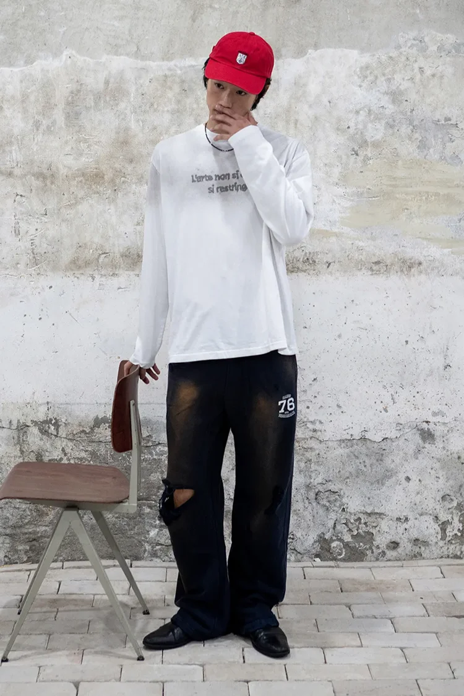

# aiPhotoAnalysis · AI 사진 분석 — 인터랙션 가이드

> 개발 전달용 인터랙션 가이드입니다. 이징·스프링은 MDS 모션 토큰(`../src/common/mds-motion.css`) 기준입니다.

- 프로토타입: `aiPhotoAnalysis/index.html` (버전 `20261117-7`)
- 수정일: 2026-11-17 (값 확정) · 2026-11-24 (문서 이름 · 핵심 인터랙션 절 정리, 값 변경 없음)
- 모션 구조는 29CM 렌즈 AI 사진 분석(2026-11-17 확정)과 같습니다. 화면 크기 · 레이아웃 · 빛 구체 색 · 결과 화면 전환(스프링)이 무신사 값입니다.
- ✅ **확정**: 이 문서의 표 · 코드 블록 값은 프로토타입과 같습니다.

## 전달 범위

| 항목 | 처리 |
|---|---|
| A. 분석 중 화면 모션 (사진 · 딤 · Light · 로딩 문구) | **코드로 처리** (A-1 ~ A-4) |
| AI 로딩 아이콘 (분석 중) | **컴포넌트 그대로** — `../src/components/IconAILoading/` (IMG CSS, 로티 버전도 있음) |
| B. 분석 완료 화면 전환 · 도트 · 상품 선택 | **코드로 처리** (B-1 ~ B-5) |
| 바텀시트 제목 AI 아이콘 | **코드로 처리** (B-7 키프레임) |

---

## 이 화면의 핵심 인터랙션 — 이것만 구현

1. **사진 등장 줌아웃 · 딤** — 1s · `mds.power2.easeOut` · 1회 (A-1)
2. **사진 숨쉬기** — 한 방향 3.0s · `mds.power1.easeInOut` · 왕복 무한 (A-2)
3. **Light 등장 · 이동** — 등장 1s · `mds.power2.easeOut` / 이동 가로 2.0s · 세로 3.0s · `mds.power1.easeInOut` · 왕복 무한 (A-3)
4. **로딩 문구 하이라이트** — 3.0s · `mds.linear` · 무한 (A-4)
5. **결과 화면 전환** (사진 축소 · 선택 영역 · 모서리 · 바텀시트, 한 프레임에서 함께) — `mds.spring.gentle` · 1회 (B-1 · B-2)
6. **도트 등장** — 0.2s · `mds.ease` · 0.25s 지연 · 1회 (B-3)
7. **도트 펄스** — 2.0s · `mds.ease` · 1.5s 지연 · 무한 (B-4)
8. **상품 선택 (썸네일 · 도트 탭)** — 선택 영역 · 모서리 이동 0.4s · `mds.power3.easeOut`, 이전 도트 나타남 0.2s · `mds.ease` (B-5)
9. **바텀시트 제목 AI 아이콘** — 등장 1.3s 1회 → 루프 scale 3.5s · rotate 12s 무한, `mds.power1.easeInOut` · `mds.power2.easeInOut` · `mds.power3.easeInOut` + rotate 등장 곡선 2개 (MDS 외) (B-7)

- 이징 · 스프링은 MDS 모션 토큰 이름입니다. 개발 쪽 같은 이름의 토큰을 쓰면 됩니다 (프로토타입 값은 `../src/common/mds-motion.css`).
- 세부 수치는 본문에만 있습니다. 위 목록은 범위와 시간 · 이징만 요약합니다.
- 그 외 파일(공통 `common.*`의 폰 프레임 · 상태바 · 페이지 로딩 · 인덱스 옵션 연결(`protoOptions`) · 목업 이미지)과 `js/flow.js` 의 옵션 받는 부분(`proto-options` · `proto-action` · `report`)은 **프로토타입 확인용**입니다. 옮기지 않습니다.
- **실서비스로 바꿀 값**: 분석 중 → 결과 화면 넘어가는 시점 (프로토타입 6초 고정 → 최소 노출 시간 ∧ 분석 결과 도착, A-5) · 상품 영역 좌표 (AI 분석 결과, B-6)

---

## 문서 구조 (먼저 읽기)

이 기능은 **화면 두 개, 상태 두 개**입니다. 문서도 그대로 두 파트로 나눴습니다.

| 파트 | 상태 | 언제 | 시간 기준 (0s) | 주요 모션 |
|---|---|---|---|---|
| **A. 분석 중 화면** | `analyzing` | 사진을 올린 직후 ~ 분석 결과가 오기 전 | 분석 중 화면이 처음 보인 순간 | 사진 줌아웃 · 숨쉬기, 딤, Light(밝힘 마스크 + 빛 구체), AI 아이콘, 로딩 문구 |
| **B. 분석 완료 화면** | `done` | 분석 결과가 온 순간 ~ | 분석 완료 순간 | 사진 축소 · 바텀시트(스프링), 선택 영역 · 모서리 등장, 도트 등장 · 펄스, 바텀시트 제목 AI 아이콘 등장 · 루프, 상품 선택 시 선택 영역 이동 |

```
[사진 업로드] → A. 분석 중 (반복 모션) ──(분석 완료: 최소 노출 시간 ∧ 결과 도착)──→ B. 분석 완료 (전환 약 0.45s → 결과 화면 대기)
                                                                                     └─ 상품 선택(썸네일 · 도트 탭) → B-5
```

### 읽는 법 (사람 · AI 공통)

- 파트 → 절(A-1, B-2 …) → **표 = 기준값(플랫폼 공통)** → **코드 = 구현 참고(웹, 프로토타입 그대로)** 순서입니다.
- 각 파트 맨 앞의 **타임라인 표(A-0 · B-0-1)** 가 그 파트 모션 전체 목록입니다. 시작 · 끝 · 시간 · 이징이 여기 다 있고, 아래 절은 세부입니다.
- 용어: **선택 영역** = 결과 화면 사진에서 선택된 상품만 밝게 보이는 둥근 사각형 창(프로토타입 `.crop-reveal`). **모서리** = 선택 영역 네 꼭짓점의 ㄱ자 표시. **도트** = 상품마다 하나씩 있는 흰 점(`.crop-point`). **펄스** = 도트에서 고리가 커지며 사라지는 반복 모션.
- iOS · Android는 표를 기준으로 옮기고, 웹은 코드 블록을 그대로 써도 됩니다.
- 모든 조절 값은 `css/values.css` 한 파일에 화면 순서대로 모여 있습니다 (1 ~ 5 = A 파트, 6 ~ 8 = B 파트).
- 코드는 프로토타입 전용 장치(인덱스 옵션 카드 연결 · QR · 휴대폰 실시간 동기화)를 뺀 모션 부분만 옮겼습니다.

---

## 공통 규칙 (A · B 모두)

| 항목 | 규칙 |
|---|---|
| 화면 | 무신사 렌즈, **375 × 812** 기준 (상태바 45 · 앱바 52) |
| 단위 | pt (375 기준) |
| 기준점 | 따로 적지 않으면 **가운데** |
| 키프레임 이징 | 구간 이징은 그 키프레임에서 다음 키프레임까지 적용 |
| 중간에 끊길 때 | 진행 중인 모션이 있으면 **지금 값에서 이어서** 새 목표로 감 (처음 값으로 되돌리지 않음) |
| 모션 줄이기 | OS 접근성 '동작 줄이기' 켜짐 → 반복 · 장식 모션(사진 등장 · 숨쉬기, 딤 등장, Light 이동, 도트 펄스)은 정지 — Light는 사진 가운데에 멈춘 채 보임. 화면 전환 · 선택 영역 이동은 바로 끝 상태 |

### 상단 (A · B 같음)

| 요소 | 값 |
|---|---|
| 상태바 | 375 × 45, 검정 바탕 · 흰 글자 (실기기는 OS 상태바) |
| 앱바 | 375 × 52 (y 45), 검정 바탕. 뒤로 아이콘 28 (x 15, 위 12) · 로고 "MUSINSA LENS beta" 141 × 17 (x 117.71, 위 17.07) · 스캔 아이콘 28 (x 331, 위 12) |
| 모션 | 없음 (A → B 전환 때도 그대로) |

### 사용한 MDS 토큰

| 토큰 | 값 | 쓰는 곳 |
|---|---|---|
| `power1.easeInOut` | cubic-bezier(0.33, 0, 0.67, 1) | 사진 숨쉬기, Light 이동 |
| `power2.easeOut` | cubic-bezier(0.25, 1, 0.5, 1) | 사진 등장 줌아웃, 딤 등장, Light 등장 |
| `power3.easeOut` | cubic-bezier(0.22, 1, 0.36, 1) | 상품 선택 시 선택 영역 이동 (B-5) |
| `spring.gentle` | stiffness **438** · damping **40** · mass 1 (iOS: duration 0.45s · dampingRatio 1 / AOS: stiffness 700 · dampingRatio 1) | 결과 화면 전환: 사진 축소 · 선택 영역 · 바텀시트 (B-1 · B-2) |

### 에셋

| 에셋 | 파일 (프로토타입) | 크기 | 비고 |
|---|---|---|---|
| 앱바 아이콘 · 로고 | `img/shared/appbar-back.svg` · `appbar-logo.svg` · `appbar-scan.svg` | 28 · 141 × 17 · 28 | |
| AI 로딩 아이콘 (분석 중) | `../src/components/IconAILoading/img-css/` (CSS + `IconAI.svg` 4장) | 32 | AI 로딩 아이콘 컴포넌트 원본 (로티 버전도 있음) |
| AI 아이콘 (바텀시트 제목) | `img/result/ic-ai.svg` | 18 | 등장 · 루프 모션 (B-7) |
| 전체 성별 + 화살표 | `img/result/sorting.png` (@2x) | 63 × 18 | 프로토타입은 동작 없는 이미지. 실서비스는 정렬 컴포넌트 |
| 결과 화면 모서리 | `img/result/crop-corner.svg` | 9 × 9, 선 2 | 왼쪽 위 모양 하나를 좌우 · 상하로 뒤집어 네 모서리에 씀 |
| 도트 | `img/result/dot.svg` | 14 | 흰 선 2 + 안쪽 검정 30% |
| 로딩 문구 글꼴 | Pretendard 500 (무신사 폰트) | 13 / 18 | 무신사 dsFont CDN |
| 사진 · 썸네일 · 상품 리스트 | `img/loading/` · `img/result/` | | 프로토타입용 (실서비스는 사용자 사진 · 검색 결과) |

---

# A. 분석 중 화면 (로딩)

> 이 파트는 **사진을 올린 순간부터 분석이 끝나기 전까지**입니다. A 파트의 시간은 모두 **분석 중 화면이 처음 보인 순간 = 0s** 기준입니다.

사진을 올리면 바로 나오는 분석 중 화면. 사진 영역은 **375 × 562, 화면 y 148** (사진 750 × 1124 비율, cover). 화면 배경은 검정.

**층 순서 (아래 → 위)**: 사진 → 딤 → ① Light 밝힘 마스크 → ② Light 빛 구체 (Orb) → ③ AI 아이콘 · 로딩 문구 / 맨 위 상태바 · 앱바 (사진 영역과 겹치지 않음)

## A-0. 분석 중 타임라인 (한눈에)

| 시작 | 끝 | 대상 | 모션 | 시간 · 이징 | 절 |
|---|---|---|---|---|---|
| 0s | 1s | 사진 | scale 1.1 → 1 (등장 줌아웃) | 1s · `power2.easeOut` | A-1 |
| 0s | 1s | 딤 | 투명도 0 → 1 (검정 60%) | 1s · `power2.easeOut` | A-1 |
| 1s | 반복 | 사진 | scale 1 ↔ 1.04 (숨쉬기) | 한 방향 3.0s · `power1.easeInOut` · 왕복 무한 | A-2 |
| 0s | 1s | Light (밝힘 마스크 + 빛 구체) | 투명도 0 → 1 (등장) | 1s · `power2.easeOut` | A-3 |
| 0s | 반복 | Light | 가로 x 60 ↔ 315 / 세로 y 60 ↔ 502 (사진 가운데에서 왼쪽 위로 출발) | 가로 한 방향 2.0s · 세로 3.0s · `power1.easeInOut` · 왕복 무한 | A-3 |
| 0s | 반복 | AI 아이콘 | 컴포넌트 원본 모션 | 1.8s · linear · 무한 | A-4 |
| 0s | 반복 | 로딩 문구 | 흰 하이라이트가 왼쪽 → 오른쪽 | 3.0s · linear · 무한 | A-4 |
| 6s | — | 화면 | 분석 완료 → B 파트로 (프로토타입 기준, 실서비스는 A-5) | — | A-5 |

---

## A-1. 사진 등장 (줌아웃) · 딤

| 대상 | 모션 | 값 |
|---|---|---|
| 사진 (사진 틀 안에서만, 기준점 가운데) | scale **1.1 → 1** | **1s** · `power2.easeOut` |
| 딤 | 투명도 0 → 1 (검정 **60%**까지) | 사진과 같이 **0s 시작 · 1s · `power2.easeOut`** |

- 사진 틀(375 × 562)은 그대로, 안의 사진만 커졌다 줄어듦 (틀 밖은 잘림)

## A-2. 사진 숨쉬기 (로딩 중 반복)

| 항목 | 값 |
|---|---|
| 모션 | scale **1 ↔ 1.04** 왕복 |
| 한 방향 시간 | **3.0s** (왕복 6s) · `power1.easeInOut` · 무한 반복 |
| 시작 | 등장 줌아웃이 끝나는 순간 (1s) — 줌아웃 끝 상태(1)에서 이어서 시작해 튀지 않음 |

```css
/* 프로토타입: css/loading.css · 값은 css/values.css 1 · 2 · 3 */
:root {
  --lens-landing-duration: 1s;
  --lens-landing-easing: var(--mds-motion-power2-easeOut);
  --lens-landing-scale: 1.1;
  --lens-breath-scale: 1.04;
  --lens-breath-duration: 3.0s;
  --lens-breath-easing: var(--mds-motion-power1-easeInOut);
  --lens-breath-delay: var(--lens-landing-duration);
  --img-dim-opacity: 0.6;
}
.lens-screen .Image {
  transform-origin: 50% 50%;
  animation:
    LensLandingZoomOut var(--lens-landing-duration) var(--lens-landing-easing) both,
    LensBreath var(--lens-breath-duration) var(--lens-breath-easing) var(--lens-breath-delay) infinite alternate;
}
@keyframes LensLandingZoomOut {
  from { transform: scale(var(--lens-landing-scale)); }
  to   { transform: scale(1); }
}
@keyframes LensBreath {
  from { transform: scale(1); }
  to   { transform: scale(var(--lens-breath-scale)); }
}
.lens-screen .Dim {
  position: absolute; inset: 0;
  background: rgb(0 0 0 / var(--img-dim-opacity));
  animation: LensDimIn var(--lens-landing-duration) var(--lens-landing-easing) both;   /* 사진 줌아웃과 같이 */
}
@keyframes LensDimIn {
  from { opacity: 0; }
  to   { opacity: 1; }
}
```

---

## A-3. Light — 사진 위를 떠다니며 밝게 비추는 빛

두 겹이 **같은 중심으로 함께** 움직입니다: A-3-1 밝힘 마스크(원본 사진이 비침) + A-3-2 빛 구체(밝힘 마스크 위에 무신사 AI 색 빛을 얹음). 이동 · 등장은 아래 표를 같이 씁니다.

### A-3-1. 밝힘 마스크

딤 위에 **원본 사진을 한 장 더** 두고, 원형 마스크로 빛이 있는 자리만 보이게 합니다. 지나가는 자리만 딤이 벗겨진 듯 밝아지고, 색은 원본 사진 그대로입니다 (색을 덧칠하지 않음).

| 항목 | 값 |
|---|---|
| 지름 | **600** (반지름 300) |
| 진하기 | **0.78** (원본 사진 층의 투명도) |
| 마스크 단계 (가운데 → 바깥) | 0% 알파 **0.62** → 45% **0.34** → 75% **0.10** → 100% 0 (원형 그라데이션, 가장자리가 부드럽게 흐려짐) |
| 실제 밝기 | 마스크 단계값 × 진하기 — 가운데 0.62 × 0.78 ≈ **0.48** |
| 이동 | 빛 중심이 사진 영역 안에서 가로 · 세로를 **따로 왕복** → 두 시간이 달라서 곡선으로 훑음 |
| 가로 범위 · 시간 | x **60 → 315** · 한 방향 **2.0s** · `power1.easeInOut` · 무한 왕복 |
| 세로 범위 · 시간 | y **60 → 502** · 한 방향 **3.0s** · `power1.easeInOut` · 무한 왕복 |
| 등장 | 투명도 0 → 1 · **사진 줌아웃과 같이 0s 시작, 1s · `power2.easeOut`** |
| 시작 위치 | **사진 가운데** — 나타나기 시작하는 순간(0s) 가로 · 세로 모두 범위 한가운데(187.5, 281)에서 **왼쪽 · 위로** 움직이기 시작 |
| 사진 모션 | 비치는 원본 사진도 A-1 · A-2(줌아웃 · 숨쉬기)를 똑같이 따라감 → 아래 사진과 늘 겹쳐 보임 |

- 범위는 빛 **중심** 기준 (사진 375 × 562 안, 가장자리에서 60씩 안쪽)
- **사진 영역과 밝힘 마스크 안 사진은 반드시 같은 크기(375 × 562)** 여야 두 사진이 정확히 겹침. 크기는 px로 고정 (iOS 사파리는 grid 안 `aspect-ratio` 상자를 늘려 cover 사진이 커지고 두 겹으로 보임)
- 시작 위치는 속도를 바꿔도 자동으로 맞음: 지연 = 등장 지연 − 한 방향 시간 × 1.5 (돌아오는 구간 한가운데, 가로 · 세로 같음)
- 구현 방법은 자유. 프로토타입은 성능을 위해 **마스크 모양은 한 번만 그리고 움직임은 모두 transform**으로 함: 원형 창이 빛과 같이 움직이고, 안쪽 사진은 같은 시간 · 곡선으로 반대로 움직여 제자리에 있음 (매 프레임 마스크 위치를 다시 그리는 방식은 CPU 부담이 큼)

```css
/* 프로토타입: css/loading.css · 값은 css/values.css 4 */
:root {
  --lens-light-size: 600px;
  --lens-light-opacity: 0.78;
  --lens-light-stop-1: 0.62;   /* 마스크 가운데 0% */
  --lens-light-stop-2: 0.34;   /* 45% */
  --lens-light-stop-3: 0.1;    /* 75% (100%는 늘 0) */
  --lens-light-x-duration: 2.0s;
  --lens-light-y-duration: 3.0s;
  --lens-light-easing: var(--mds-motion-power1-easeInOut);
  --lens-light-x-from: 60px;  --lens-light-x-to: 315px;
  --lens-light-y-from: 60px;  --lens-light-y-to: 502px;
  --lens-light-in-delay: 0s;
  --lens-light-in-duration: var(--lens-landing-duration);
  --lens-light-in-easing: var(--lens-landing-easing);
}
/* 구조: .LensLight(등장) > .LensLightX > .LensLightY(빛 중심 이동) > .LensLightMask(원형 창)
         > .LensLightMaskY > .LensLightMaskX(반대로 이동) > .Image.LensLightImage(원본 사진) */
.lens-screen .LensLight {
  position: absolute; inset: 0; overflow: hidden; pointer-events: none;
  opacity: 0;
  animation: LensLightIn var(--lens-light-in-duration) var(--lens-light-in-easing) var(--lens-light-in-delay) forwards;
}
.lens-screen .LensLightX,
.lens-screen .LensLightY,
.lens-screen .LensLightMaskX { position: absolute; left: 0; top: 0; will-change: transform; }
/* 시작 위치: 사진 가운데, 왼쪽 위로 출발 */
.lens-screen .LensLightX,
.lens-screen .LensLightMaskX {
  --lens-light-x-delay: calc(var(--lens-light-in-delay) - var(--lens-light-x-duration) * 1.5);
}
.lens-screen .LensLightY,
.lens-screen .LensLightMaskY {
  --lens-light-y-delay: calc(var(--lens-light-in-delay) - var(--lens-light-y-duration) * 1.5);
}
.lens-screen .LensLightX { animation: LensLightMoveX var(--lens-light-x-duration) var(--lens-light-easing) var(--lens-light-x-delay) infinite alternate; }
.lens-screen .LensLightY { animation: LensLightMoveY var(--lens-light-y-duration) var(--lens-light-easing) var(--lens-light-y-delay) infinite alternate; }
.lens-screen .LensLightMask {
  position: absolute;
  left: calc(var(--lens-light-size) / -2);
  top: calc(var(--lens-light-size) / -2);
  width: var(--lens-light-size);
  height: var(--lens-light-size);
  opacity: var(--lens-light-opacity);
  mask-image: radial-gradient(circle closest-side,
    rgb(0 0 0 / var(--lens-light-stop-1)) 0%, rgb(0 0 0 / var(--lens-light-stop-2)) 45%,
    rgb(0 0 0 / var(--lens-light-stop-3)) 75%, rgb(0 0 0 / 0) 100%);
}
.lens-screen .LensLightMaskY {
  position: absolute;
  left: calc(var(--lens-light-size) / 2);
  top: calc(var(--lens-light-size) / 2);
  will-change: transform;
  animation: LensLightBackY var(--lens-light-y-duration) var(--lens-light-easing) var(--lens-light-y-delay) infinite alternate;
}
.lens-screen .LensLightMaskX { animation: LensLightBackX var(--lens-light-x-duration) var(--lens-light-easing) var(--lens-light-x-delay) infinite alternate; }
.lens-screen .LensLightImage { position: absolute; left: 0; top: 0; width: 375px; height: 562px; }
@keyframes LensLightIn    { to { opacity: 1; } }
@keyframes LensLightMoveX { from { transform: translateX(var(--lens-light-x-from)); } to { transform: translateX(var(--lens-light-x-to)); } }
@keyframes LensLightMoveY { from { transform: translateY(var(--lens-light-y-from)); } to { transform: translateY(var(--lens-light-y-to)); } }
@keyframes LensLightBackX { from { transform: translateX(calc(var(--lens-light-x-from) * -1)); } to { transform: translateX(calc(var(--lens-light-x-to) * -1)); } }
@keyframes LensLightBackY { from { transform: translateY(calc(var(--lens-light-y-from) * -1)); } to { transform: translateY(calc(var(--lens-light-y-to) * -1)); } }
```

```html
<!-- 프로토타입: index.html — 사진 영역(.AILoading) 안, AI 아이콘 · 문구보다 앞(아래 층) -->
<div class="LensLight" aria-hidden="true"><div class="LensLightX"><div class="LensLightY">
  <div class="LensLightMask"><div class="LensLightMaskY"><div class="LensLightMaskX">
    <div class="Image LensLightImage"></div>
  </div></div></div>
  <div class="LensOrb"></div>  <!-- 빛 구체 (밝힘 마스크 위) -->
</div></div></div>
```

### A-3-2. 빛 구체 (Orb)

밝힘 마스크 **위**에 얹는 **무신사 AI 색 빛**. 원형 그라데이션을 둥글게 자른 뒤 blur.

| 색 | 색상 | 위치 (반지름 기준: 0% = 가운데, 100% = 원 끝) | 진하기 (알파) |
|---|---|---|---|
| Color 1 | `#86BAFF` | 15% | 0.50 |
| Color 2 | `#E476FF` | 45% | 0.50 |
| Color 3 | `#878FFF` | 85% (= Fade start) | 0.50 |
| Fade end | Color 3 | 90% | 0 (85% → 90%에서 투명해짐) |

| 항목 | 값 |
|---|---|
| 색 | 무신사 AI 효과 색 (`#86BAFF` · `#E476FF` · `#878FFF`) |
| 지름 | **560** (원형으로 자름, 90% 바깥은 투명) |
| 진하기 | **0.40** (층 전체) |
| 흐림 | blur **30** |
| 블렌드 | Normal |
| 층 순서 | **밝힘 마스크 위** |
| 이동 · 등장 | 밝힘 마스크와 같은 중심 · 같은 등장 (A-3 표) |

```css
/* 프로토타입: css/loading.css · 값은 css/values.css 4-2 */
:root {
  --lens-orb-size: 560px;
  --lens-orb-opacity: 0.4;
  --lens-orb-blur: 30px;
  --lens-orb-color-1: #86baff;  --lens-orb-pos-1: 15%;  --lens-orb-stop-1: 0.5;
  --lens-orb-color-2: #e476ff;  --lens-orb-pos-2: 45%;  --lens-orb-stop-2: 0.5;
  --lens-orb-color-3: #878fff;  --lens-orb-pos-3: 85%;  --lens-orb-stop-3: 0.5;   /* 색 3 위치 = Fade start */
  --lens-orb-end: 90%;          /* Fade end */
}
/* .LensLightY(빛 중심) 안. 층 순서: 빛 구체가 밝힘 마스크 위 */
.lens-screen .LensLightMask { z-index: 1; }
.lens-screen .LensOrb { z-index: 2; }
.lens-screen .LensOrb {
  position: absolute;
  left: calc(var(--lens-orb-size) / -2);
  top: calc(var(--lens-orb-size) / -2);
  width: var(--lens-orb-size);
  height: var(--lens-orb-size);
  border-radius: 50%;
  opacity: var(--lens-orb-opacity);
  filter: blur(var(--lens-orb-blur));
  background: radial-gradient(circle closest-side at 50% 50%,   /* closest-side: 100% = 원 끝 */
    rgb(from var(--lens-orb-color-1) r g b / var(--lens-orb-stop-1)) var(--lens-orb-pos-1),
    rgb(from var(--lens-orb-color-2) r g b / var(--lens-orb-stop-2)) var(--lens-orb-pos-2),
    rgb(from var(--lens-orb-color-3) r g b / var(--lens-orb-stop-3)) var(--lens-orb-pos-3),
    rgb(from var(--lens-orb-color-3) r g b / 0) var(--lens-orb-end));
  will-change: transform;
}
```

---

## A-4. AI 아이콘 · 로딩 문구

사진 영역 가운데, 아이콘 32 아래 간격 6에 문구 "AI가 사진을 분석중입니다". **사진 영역에서 가장 위 층** (Light보다 위).

| 대상 | 모션 | 값 |
|---|---|---|
| AI 로딩 아이콘 | 컴포넌트 원본 그대로 | 32 · 한 바퀴 **1.8s** · linear · 무한 반복 (AI 로딩 아이콘 컴포넌트 CSS 기준) |
| 로딩 문구 | 글자 색 흰색 70% 고정, 흰 하이라이트가 왼쪽 → 오른쪽으로 지나감 | 주기 **3.0s** · linear · 무한 반복 |
| | 하이라이트 | 90° 선형 그라데이션 (투명 → 흰색 100% → 투명), 폭은 문구 너비의 **20%** |
| 글꼴 | Pretendard 500 · 13 / 18 | 무신사 폰트 |

```css
/* 프로토타입: css/loading.css · 값은 css/values.css 5 */
.lens-screen .LoadingMsg p {
  position: relative;
  margin: 0;
  font-family: Pretendard, -apple-system, BlinkMacSystemFont, sans-serif;
  font-size: 13px; font-weight: 500; line-height: 18px;
  color: rgb(255 255 255 / 0.7);
}
.lens-screen .LoadingMsg p[data-text]::after {   /* 같은 글자를 겹쳐 하이라이트만 보이게 */
  content: attr(data-text);
  position: absolute; inset: 0;
  color: transparent;
  background-image: linear-gradient(90deg, transparent 0%, #fff 50%, transparent 100%);
  background-size: 20% 100%;
  background-repeat: no-repeat;
  background-position: -100% 0;
  -webkit-background-clip: text;
  background-clip: text;
  animation: LoadingMsgShimmer 3s linear infinite;
}
@keyframes LoadingMsgShimmer {
  0%   { background-position: -100% 0; }
  100% { background-position: 200% 0; }
}
```

---

## A-5. 노출 시간 · 결과 화면으로

| 항목 | 값 |
|---|---|
| 프로토타입 | **6초** 뒤 자동으로 결과 화면 (B 파트) |
| 실서비스 (제안) | 최소 노출 시간이 지나고 **분석 결과가 오면** 넘어감 (둘 중 늦은 쪽) — 최소 시간은 디자이너 확인 후 확정 |
| 결과 화면 전환 시점의 사진 | 줌아웃 · 숨쉬기 중 **지금 배율에서 이어서** 결과 크기로 줄어듦 (B-1) |

---

# B. 분석 완료 화면 (결과)

> 이 파트는 **분석이 끝난 순간부터**입니다. 분석 중 화면(A)이 결과 화면으로 바뀌는 전환(B-1 ~ B-4)과, 결과 화면에서 상품을 고를 때의 모션(B-5)을 다룹니다.
> B 파트의 시간은 모두 **분석 완료 순간 = 0s** 기준입니다.

## B-0. 화면 구성

결과 화면 375 × 812 = **상태바 45 · 앱바 52 · 사진 영역 320 (y 97) · 바텀시트 395 (y 417)**. 화면 배경은 검정.

**사진 영역 층 순서 (아래 → 위)**

| 층 | 요소 (프로토타입 클래스) | 내용 |
|---|---|---|
| 1 | 사진 `.crop-photo` | **200 × 300** (사진 영역 위 10 = 화면 y 107, 가로 가운데 x 87.5), cover |
| 2 | 딤 `.crop-dim` | 사진과 같은 자리 · 크기, 검정 **60%** (분석 중 딤과 같음) |
| 3 | 선택 영역 (밝은 창) `.crop-reveal` | 같은 사진을 한 장 더 두고 **둥근 사각형(모서리 4)으로 잘라** 선택된 상품만 밝게 보임 |
| 4 | 모서리 4개 `.crop-corner.is-tl` · `.is-tr` · `.is-bl` · `.is-br` | 선택 영역 네 꼭짓점의 ㄱ자 표시 (9 × 9, 흰 선 2). 선 안쪽이 선택 영역 테두리에 닿음 (창 밖으로 2) |
| 5 | 도트 `.crop-point` | 상품마다 하나, 14 (흰 선 2 + 안쪽 검정 30%) + 펄스 고리. **선택된 상품의 도트는 숨김** |

**바텀시트** — 375 × 395, 배경 gray100 `#F5F5F5`, 위 모서리 8

| 영역 | 높이 | 내용 |
|---|---|---|
| 손잡이 | 20 | 36 × 4, gray300 `#E0E0E0`, 모서리 10, 위 8 |
| 제목 | 39 | 위 8 · 아래 11 · 좌우 16. AI 아이콘 18 + 간격 4 + "AI가 이미지와 비슷한 상품을 찾았어요" (Body/14_medium, Pretendard 500 14 / 20, 검정) |
| 썸네일 탭 | 66 | 좌우 16 · 아래 12. 54 원 썸네일 3개 (간격 10) + 오른쪽 아래 "전체 성별 ⌄" 63 × 18 |
| 상품 리스트 | 270 | 선택한 상품의 비슷한 상품 목록 (3열) |

| 썸네일 | 모양 |
|---|---|
| 선택 | 테두리 검정 1 + 그 안쪽 gray100 1 (이미지 위에 겹침) |
| 미선택 | 테두리 검정 8% 1 |
| 공통 | 54 원, 이미지 위 검정 2% 딤 |

## B-0-1. 분석 완료 타임라인 (한눈에)

| 시작 | 끝 | 대상 | 모션 | 시간 · 이징 | 절 |
|---|---|---|---|---|---|
| 0s | ≈ 0.37s (멈춤) | 사진 · 딤 | 분석 중 크기(375 × 562) → 결과 크기(200 × 300) | `spring.gentle` · 지연 없음 | B-1 |
| 0s | ≈ 0.37s | 선택 영역 · 모서리 | 첫 상품 가운데 한 점에서 펼쳐지며 나타남 | `spring.gentle` · 지연 없음 | B-2 |
| 0s | ≈ 0.37s | 바텀시트 | 화면 아래 → 제자리 | `spring.gentle` · **지연 없음** (사진과 같이 출발) | B-1 |
| 0.25s | 0.45s | 도트 (선택 안 된 상품) | 투명도 0 → 1 | 0.2s · ease · 0.25s 지연 | B-3 |
| 1.5s | 반복 | 도트 펄스 | 고리가 커지며 사라짐, 무한 반복 | 2.0s · ease · 1.5s 지연 | B-4 |
| ≈ 0.37s | ≈ 1.67s | 바텀시트 제목 AI 아이콘 | **바텀시트 등장이 끝나면** 등장: scale 0 → 1.2 → 1 · rotate −140° → −20° → 0° (그 전까지는 scale 0으로 숨김) | 1.3s · 1회 (B-7 키프레임) | B-7 |
| ≈ 1.67s | 반복 | 바텀시트 제목 AI 아이콘 | 루프: scale 3.5s · rotate 12s 따로 반복 | 무한 (B-7 키프레임) | B-7 |

```
0s          0.25s     0.37s  0.45s                1.5s
|-- 사진·딤·선택영역·모서리·바텀시트 (spring.gentle) --|
            |--- 도트 0.2s ---|
                                                   |펄스 2.0s 반복 →
```

- 스프링은 시간이 아니라 힘(stiffness · damping)으로 움직입니다. `spring.gentle`(438 · 40, 감쇠비 ≈ 0.96)은 튀지 않고(넘침 0.004%) 진행률이 0.1s ≈ 64% · 0.2s ≈ 94% · 0.3s ≈ 99%, **약 0.37s에 멈춥니다** (MDS iOS duration 0.45s와 같은 느낌).
- iOS는 `spring(duration: 0.45, bounce: 0)` (dampingRatio 1), AOS는 stiffness 700 · dampingRatio 1 (MDS 토큰)을 쓰면 됩니다.

---

## B-1. 사진 축소 · 바텀시트 등장

| 대상 | 시작 (분석 중 화면과 같은 자리) | 끝 | 값 |
|---|---|---|---|
| 사진 · 딤 | 375 × 562 (화면 y 148 = 사진 영역 위 51), 배율 = 분석 중 사진의 **지금 배율** | **200 × 300** (사진 영역 위 10, 가로 가운데), 배율 1 | **`spring.gentle`** · 지연 없음 |
| 딤 색 | 검정 60% 고정 | 같음 | 크기만 사진과 같이 바뀜 |
| 바텀시트 | translateY(100%) (화면 아래 바깥) | translateY(0) | **`spring.gentle`** · **지연 없음** — 사진 축소와 같은 스프링 · 같은 프레임 |

- **지금 배율에서 이어서**: 분석 중 사진은 등장 줌아웃 · 숨쉬기로 1 ~ 1.1배 사이에 있음. 완료 순간의 배율을 읽어, 결과 사진이 그 배율에서 1로 **같은 스프링으로** 줄어듦 → 화면이 튀지 않음
- 사진은 크기가 바뀌는 동안에도 비율대로 채움(cover)
- 분석 중 화면의 Light · AI 아이콘 · 로딩 문구는 완료 순간 바로 사라짐 (화면 교체). 상태바 · 앱바는 그대로

## B-2. 선택 영역 · 모서리 등장

| 대상 | 시작 | 끝 | 값 |
|---|---|---|---|
| 선택 영역 | **첫 상품 영역의 가운데 한 점** (분석 중 크기 사진 위 좌표, 모서리 0) · 투명도 0 | 첫 상품 영역 (결과 크기 사진 위, 모서리 4) · 투명도 1 | B-1과 **같은 `spring.gentle`, 같은 프레임에서** |
| 모서리 4개 | 같은 한 점 · 투명도 0 | 선택 영역 꼭짓점 · 투명도 1 | 위와 같음 |

- 시작 화면이 분석 중 화면(사진 전체가 어두움)과 같아 끊김 없이 이어짐
- 사진 · 딤 · 선택 영역 · 모서리 · 바텀시트는 **한 프레임에서 함께** 그려야 어긋나 보이지 않음 (프로토타입은 매 프레임 직접 계산 — 아래 코드)
- 선택 영역 크기 · 위치 계산은 B-6

## B-3. 도트 등장

| 항목 | 값 |
|---|---|
| 대상 | **선택되지 않은 상품의 도트**만 (선택된 상품의 도트는 처음부터 숨김) |
| 모션 | 투명도 0 → 1 |
| 시간 | **0.2s** · ease · **0.25s 지연** — 전환이 거의 끝나는 0.45s(`spring.gentle` iOS duration)에 같이 끝나도록 (지연 = 0.45 − 0.2) |
| 위치 | 결과 크기 사진 위 상품의 `point` 좌표 (B-6). **움직이지 않음** (제자리에서 나타남) |

## B-4. 도트 파형 (펄스)

| 항목 | 값 |
|---|---|
| 모양 | 도트와 같은 **14 원 고리**, 흰색 70% 선 **1.4** (도트 가운데 기준) |
| 모션 | scale **1 → 2** + 투명도 **0.7 → 0** (커지며 사라짐) |
| 시간 | 한 번 **2.0s** · ease · 무한 반복 |
| 시작 | 결과 화면이 보인 뒤 **1.5s** |
| 동작 줄이기 | 펄스 고리 숨김 |

## B-5. 상품 선택 (썸네일 · 도트를 누를 때)

바텀시트 썸네일 또는 사진 위 도트를 누르면 그 상품으로 선택이 바뀝니다.

| 대상 | 모션 | 값 |
|---|---|---|
| 선택 영역 · 모서리 4개 | 지금 상품 영역 → 새 상품 영역으로 **이동 · 크기 변경** (같이 출발, 같이 도착) | **0.4s** · `power3.easeOut` |
| 도트 — 새로 선택한 상품 | 바로 숨김 | 모션 없음 |
| 도트 — 이전에 선택돼 있던 상품 | 투명도 0 → 1 | **0.2s** · ease |
| 도트 위치 | **이동하지 않음** (모든 도트는 각자 상품 자리에 고정) | — |
| 썸네일 | 선택 표시 이동 (B-0 썸네일 모양) | 모션 없이 바로 |
| 상품 리스트 | 선택한 상품의 리스트로 교체 | 모션 없이 바로 |

- **움직이는 것은 선택 영역 · 모서리뿐**입니다. 도트는 숨김 · 나타남만 있고 자리를 옮기지 않습니다.
- 이동 중에 다른 상품을 누르면 **지금 보이는 위치 · 크기에서 이어서** 새 상품으로 감 (처음 값으로 되돌리지 않음)
- 이미 선택된 상품을 다시 누르면 아무 변화 없음
- 도트 누르는 영역: **46 × 46** (도트 14 + 사방 16)

## B-6. 위치 계산 (AI 분석 결과 좌표)

선택 영역 · 모서리 · 도트 위치는 AI 분석 결과의 **비율 좌표**로 계산합니다. 어떤 크기의 사진이 와도 같은 방식입니다.

| 값 | 내용 |
|---|---|
| `box` | 사진 안 상품 영역 — x · y(왼쪽 위) · w · h, **사진 원본 기준 0 ~ 1 비율** |
| `point` | 도트 자리 (0 ~ 1 비율). 없으면 `box` 가운데 |
| 사진 틀 | 결과: **200 × 300** (사진 영역 위 10) / 분석 중: **375 × 562** (사진 영역 위 51). 사진은 틀에 cover |
| 비율 → 틀 좌표 | cover 확대 배율을 곱하고, 넘쳐서 잘린 양(가로 · 세로 절반씩)을 뺌 |
| 선택 영역 | `box`를 틀 좌표로 바꾼 사각형. 틀 밖은 잘라 냄, **최소 24 × 24** (작으면 가운데 기준으로 키움), 모서리 4 |
| 선택 영역 시작점 (B-2) | `box` 가운데를 **분석 중 틀(375 × 562)** 좌표로 바꾼 한 점 |
| 모서리 위치 | 9 × 9 상자, 선 두께 2. 선 안쪽이 창 테두리에 닿도록 **창 밖으로 2**: 왼쪽 위 상자 (창 왼쪽 − 2, 창 위 − 2) · 오른쪽 위 (창 오른쪽 − 7, 창 위 − 2) · 왼쪽 아래 (창 왼쪽 − 2, 창 아래 − 7) · 오른쪽 아래 (창 오른쪽 − 7, 창 아래 − 7). 오른쪽은 좌우, 아래는 상하로 뒤집음 |
| 도트 위치 | `point`를 결과 틀 좌표로 바꾼 점이 도트 가운데 (틀 밖이면 틀 끝으로 붙임) |

---

## B-7. 바텀시트 제목 AI 아이콘 (등장 · 루프)

제목 "AI가 이미지와 비슷한 상품을 찾았어요" 앞 18 아이콘. **바텀시트 등장이 끝나는 순간(스프링이 멈추는 ≈ 0.37s) 등장 1회 → 이어서 루프**. 바텀시트가 올라오는 동안은 등장 시작 값(scale 0)으로 숨겨 둡니다. 기준점은 가운데, 투명도는 바꾸지 않고 스케일 0에서 시작합니다. scale과 rotate는 **서로 다른 애니메이션 두 개**로 따로 돕니다 (루프 주기가 달라 하나로 합치면 안 됨). 무신사 IconAI 컴포넌트 모션과 같은 값입니다 (앱테크 취향선택브랜드 바텀시트와 같음).

**등장 (1.3s, 1회)**

| 속성 | 키프레임 | 이징 |
|---|---|---|
| scale | 0 (0%) → **1.2** (25%) → 1 (100%) | 0→25%: `power3.easeInOut` · 25→100%: `power1.easeInOut` |
| rotate | −140° (0%) → −20° (33%) → 0° (100%) | 0→33%: cubic-bezier(0.33, 0, 0.2, 0.8) · 33→100%: cubic-bezier(0.5, 1, 0.36, 1) |

> rotate 곡선 2개는 이 아이콘 전용 값입니다 (MDS 토큰 아님).

**루프 (등장의 rotate가 끝나는 순간 시작, 무한 반복)**

| 속성 | 주기 | 키프레임 | 이징 |
|---|---|---|---|
| scale | **3.5s** | 1 (0%) → 0.8 (25%) → 1.2 (75%) → 1 (100%) | `power1.easeInOut` |
| rotate | **12s** | 0° (0%) → 115° (16.67%) → 90° (33.33%) → 0° (50%) → 0° (66.67%, 정지) → −30° (83.33%) → 0° (100%) | 0% · 66.67% 구간: `power2.easeInOut`, 그 외 `power1.easeInOut` |

- 등장 끝 상태(scale 1 · 0°)와 루프 시작 값이 같아서 이어 붙여도 튀지 않음
- 두 주기(3.5s · 12s)는 일부러 나누어떨어지지 않게 둠 (반복 인상 줄이기)
- 시작 시점: 바텀시트 등장(B-1 스프링)이 **끝나는 순간** — 시간을 따로 정하지 않고 시트 모션이 끝나면 바로 시작
- 결과 화면이 다시 나올 때마다(다시 분석) 대기(scale 0)부터 다시
- 모션 줄이기 설정에서는 정지

```css
/* 프로토타입: css/result.css */
.ai-icon {
  transform-origin: center;
  scale: 1;
  rotate: 0deg;
}
.ai-icon.is-wait { scale: 0; }   /* 바텀시트가 올라오는 동안 (등장 시작 값과 같음) */
.ai-icon.is-entrance {
  animation: aiEntranceScale 1.3s forwards, aiEntranceRotate 1.3s forwards;
}
.ai-icon.is-loop {
  animation: aiLoopScale 3.5s var(--mds-motion-power1-easeInOut) infinite,
             aiLoopRotate 12s var(--mds-motion-power1-easeInOut) infinite;
}
@keyframes aiEntranceScale {
  0%   {scale: 0;   animation-timing-function: var(--mds-motion-power3-easeInOut);}
  25%  {scale: 1.2; animation-timing-function: var(--mds-motion-power1-easeInOut);}
  100% {scale: 1;}
}
@keyframes aiEntranceRotate {
  0%   {rotate: -140deg; animation-timing-function: cubic-bezier(0.33, 0, 0.2, 0.8);}
  33%  {rotate: -20deg;  animation-timing-function: cubic-bezier(0.5, 1, 0.36, 1);}
  100% {rotate: 0deg;}
}
@keyframes aiLoopScale {
  0%   {scale: 1;}
  25%  {scale: 0.8;}
  75%  {scale: 1.2;}
  100% {scale: 1;}
}
@keyframes aiLoopRotate {
  0%     {rotate: 0deg;   animation-timing-function: var(--mds-motion-power2-easeInOut);}
  16.67% {rotate: 115deg;}
  33.33% {rotate: 90deg;}
  50%    {rotate: 0deg;}
  66.67% {rotate: 0deg;   animation-timing-function: var(--mds-motion-power2-easeInOut);}
  83.33% {rotate: -30deg;}
  100%   {rotate: 0deg;}
}
@media (prefers-reduced-motion: reduce) {
  .ai-icon.is-entrance, .ai-icon.is-loop {animation: none;}
}
```

```js
// 프로토타입: js/flow.js · js/result.js — 분석 완료 시 holdTitleIcon() (scale 0 대기),
// 바텀시트 frameMotion 이 끝나면 onDone 으로 playTitleIcon(), 다시 로딩하면 resetTitleIcon()
holdTitleIcon();
frameMotion(function () { result.classList.remove('is-sheet-down'); },
            '--lens-sheet-duration', '--lens-sheet-easing', zoomNow, playTitleIcon);

function playTitleIcon() {
    icon.classList.remove('is-wait', 'is-entrance', 'is-loop');
    void icon.offsetWidth;                 // 클래스를 다시 붙여도 처음부터 재생되게
    icon.classList.add('is-entrance');
}
icon.addEventListener('animationend', function (e) {   // 등장 rotate가 끝나면 루프로
    if (e.target !== icon || e.animationName !== 'aiEntranceRotate' || !icon.classList.contains('is-entrance')) return;
    icon.classList.replace('is-entrance', 'is-loop');
});
```

---

## B 코드 (프로토타입, 구현 참고)

```js
// 프로토타입: js/flow.js — 분석 완료 → 결과 화면 (요약)
// 분석 중 사진의 지금 배율을 읽어, 결과 사진이 그 배율에서 1로 같은 스프링으로 줄어들게 함
var t = getComputedStyle(loadingImage).transform;
var zoomNow = (t && t !== 'none') ? new DOMMatrixReadOnly(t).a : 1;
loadingScreen.hidden = true;
resultScreen.hidden = false;
// is-sheet-down 을 떼면: 사진 · 딤 · 선택 영역 · 모서리 · 바텀시트를 frameMotion이 spring.gentle 로 매 프레임 함께 그림 (B-1 · B-2)
// 도트는 CSS transition (B-3)
holdTitleIcon();   // 바텀시트 제목 AI 아이콘: 시트가 올라오는 동안 scale 0 (B-7)
frameMotion(function () { result.classList.remove('is-sheet-down'); },
            '--lens-sheet-duration', '--lens-sheet-easing', zoomNow,
            playTitleIcon);   // 시트 등장이 끝나면 아이콘 등장 → 루프 (B-7)

// 프로토타입: js/result.js — 상품 선택 (B-5)
// 선택 영역 · 모서리만 0.4s · power3.easeOut 으로 이동, 도트 · 썸네일 · 리스트는 클래스만 바꿈
frameMotion(function () { photo.dataset.focus = id; }, '--lens-focus-duration', '--lens-focus-easing');

// frameMotion(applyChange, 시간, 이징, 시작 배율):
//  1) 지금 보이는 값(이동 중이면 중간값)을 읽고  2) applyChange()로 끝 상태 클래스를 붙인 뒤 끝 값을 읽고
//  3) requestAnimationFrame 으로 두 값 사이를 채움 (사진 top·width·height, 선택 영역 clip-path inset, 모서리 top·left, 투명도, 바텀시트 translateY)
//  이징 값이 spring(stiffness, damping) 이면 스프링 진행률, cubic-bezier 면 시간 곡선
//  5번째 인자 onDone: 모션이 끝나면 한 번 부름 (끝나기 전에 다른 모션이 시작되면 그때 바로)
//  선택 영역(clip-path)과 모서리(left·top)를 같은 프레임에서 그려야 어긋나지 않음
```

```js
// 프로토타입: js/result.js — 스프링 진행률 (mass 1, 시작 0 → 끝 1). spring.gentle: k 438, c 40
function springAt(k, c) {
    var w0 = Math.sqrt(k), z = c / (2 * w0);              // z ≈ 0.956 (1보다 조금 작음 → 넘침 0.004%)
    var wd = w0 * Math.sqrt(1 - z * z);
    return function (t) {                                  // t: 초
        return 1 - Math.exp(-z * w0 * t) * (Math.cos(wd * t) + (z * w0 / wd) * Math.sin(wd * t));
    };
}
// 끝: 끝 값과의 차이가 0.1% 안으로 들어오는 시간(≈ 0.373s)에 끝 상태로 고정
```

```js
// 프로토타입: js/result.js — 비율 좌표 → 틀 안 좌표 (B-6)
function frameGeom(frame, imageW, imageH) {
    var scale = Math.max(frame.w / imageW, frame.h / imageH);
    var dw = imageW * scale, dh = imageH * scale;
    return { w: frame.w, h: frame.h, dw: dw, dh: dh, ox: (dw - frame.w) / 2, oy: (dh - frame.h) / 2 };
}
function toFrame(g, nx, ny) { return { x: nx * g.dw - g.ox, y: ny * g.dh - g.oy }; }
// 선택 영역 = toFrame(box 왼쪽 위) ~ toFrame(box 오른쪽 아래), 틀 밖은 잘라 냄, 최소 24 × 24
// 시작점 = toFrame(분석 중 틀 375 × 562, box 가운데) / 도트 = toFrame(결과 틀 200 × 300, point)
```

```css
/* 프로토타입: css/result.css · 값은 css/values.css 6 · 7 · 8 */
:root {
  /* B-1 · B-2: 사진 축소 · 선택 영역 · 바텀시트 (js/result.js 가 spring(...) 을 읽어 스프링으로 계산) */
  --lens-sheet-easing: spring(var(--mds-motion-spring-gentle-stiffness), var(--mds-motion-spring-gentle-damping));   /* 438, 40 */
  --lens-sheet-duration: var(--mds-motion-spring-gentle-ios-duration);   /* 0.45s — B-3 도트 지연 계산용 */
  --lens-overlay-duration: 0.2s;  /* B-3 */
  --lens-overlay-easing: ease;
  --lens-focus-duration: 0.4s;    /* B-5 */
  --lens-focus-easing: var(--mds-motion-power3-easeOut);
  --lens-point-in-duration: 0.2s; /* B-5 도트 다시 나타남 */
  --lens-point-in-easing: ease;
  --lens-pulse-duration: 2.0s;    /* B-4 */
  --lens-pulse-easing: ease;
  --lens-pulse-delay: 1.5s;
  --lens-pulse-scale: 2.0;
  --lens-pulse-opacity: 0.7;
}
/* B-1 바텀시트: 시작 · 끝 상태만 (움직임은 js/result.js 스프링) */
.lens-result-sheet {
  position: absolute; left: 0; right: 0; bottom: 0;
  height: 395px;
  border-radius: 8px 8px 0 0;
  background: #f5f5f5;
  transform: translateY(0);
}
.lens-result.is-sheet-down .lens-result-sheet { transform: translateY(100%); }
/* B-2 시작 상태: 선택 영역 · 모서리 투명 (위치는 상품 좌표로 계산) */
.lens-result.is-sheet-down .crop-reveal { opacity: 0; }
.lens-result.is-sheet-down .crop-corner { opacity: 0; }
/* B-3 도트 묶음: 전환이 거의 끝나는 0.45s에 같이 다 나타남 */
.lens-result-photo .crop-points {
  opacity: 1;
  transition: opacity var(--lens-overlay-duration) var(--lens-overlay-easing) max(0s, calc(var(--lens-sheet-duration) - var(--lens-overlay-duration)));
}
.lens-result.is-sheet-down .crop-points { opacity: 0; transition: none; }
/* B-5 도트 하나: 선택된 상품은 바로 숨김, 나머지는 0.2s로 나타남 */
.lens-result-photo .crop-point { opacity: 1; transition: opacity var(--lens-point-in-duration) var(--lens-point-in-easing); }
.lens-result-photo .crop-point.is-current { opacity: 0; pointer-events: none; transition: none; }
.lens-result-photo .crop-point::before { content: ""; position: absolute; inset: -16px; border-radius: 50%; }   /* 누르는 영역 46 × 46 */
/* B-4 펄스 고리 */
.lens-result-photo .crop-point::after {
  content: "";
  position: absolute; left: 50%; top: 50%;
  width: 14px; height: 14px; margin: -7px 0 0 -7px;
  box-sizing: border-box;
  border: 1.4px solid rgba(255, 255, 255, 0.7);
  border-radius: 50%;
  animation: LensPointPulse var(--lens-pulse-duration) var(--lens-pulse-easing) var(--lens-pulse-delay) infinite;
}
@keyframes LensPointPulse {
  0%   { transform: scale(1); opacity: var(--lens-pulse-opacity); }
  100% { transform: scale(var(--lens-pulse-scale)); opacity: 0; }
}
```

```json
// 프로토타입: index.html 의 lensResultData — 상품 3개 (사진 원본 기준 0 ~ 1 비율)
{ "id": "top",    "name": "상의", "box": { "x": 0.2575, "y": 0.163,  "w": 0.485, "h": 0.38  } }
{ "id": "bottom", "name": "하의", "box": { "x": 0.349,  "y": 0.503,  "w": 0.298, "h": 0.418 }, "point": { "x": 0.4975, "y": 0.72 } }
{ "id": "cap",    "name": "모자", "box": { "x": 0.44,   "y": 0.0445, "w": 0.153, "h": 0.093 }, "point": { "x": 0.5225, "y": 0.0767 } }
```

---

## 추후 정의

| 항목 | 상태 |
|---|---|
| 실서비스 최소 노출 시간 (A-5) | 디자이너 확인 후 확정 |

## 프로토타입 파일 구성

| 파일 | 내용 | 전달 |
|---|---|---|
| `css/values.css` | 조절 값 전부 (1 ~ 5 = A 파트, 6 ~ 8 = B 파트) | ✅ |
| `css/loading.css` | 상태바 · 앱바, A. 분석 중 화면 | ✅ |
| `css/result.css` | B. 분석 완료 화면 · 바텀시트 | ✅ |
| `js/result.js` | B. 결과 화면 모션(frameMotion · 스프링) · 상품 좌표 계산 | ✅ |
| `js/flow.js` | A → B 흐름, 분석 시간 (옵션 받는 부분 `proto-options` · `proto-action` · `report` 는 프로토타입 전용) | ✅ |
| `css/layout.css` | 폰 틀 · 휴대폰 화면 맞춤 | 참고 |
| (인덱스 옵션 카드) | 분석 시간 · 로딩만 보기 · 로딩 완료 · 다시 로딩 — 흐름 확인용, 프로토타입 폴더 밖 `index.html` | ❌ 프로토타입 전용 |
| `img/_source/` | 받은 원본 이미지 (png) | ❌ 원본 보관 |
